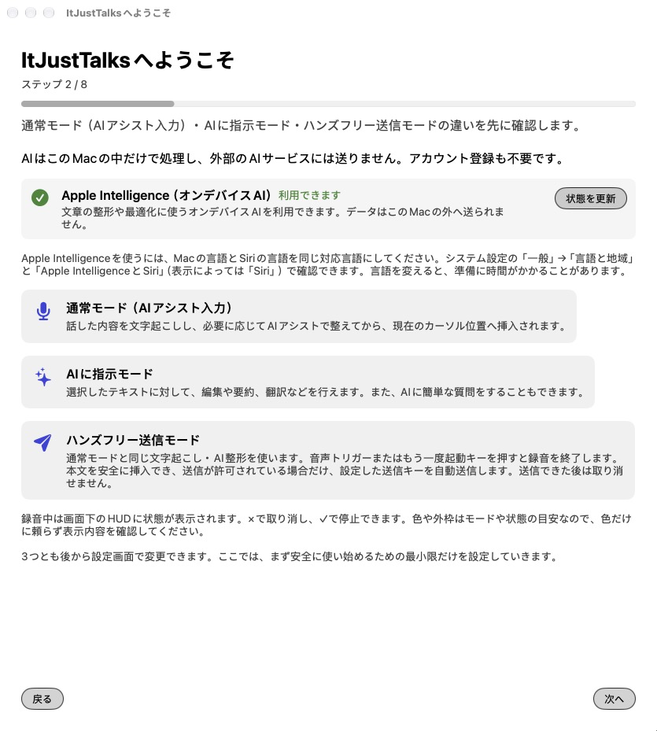
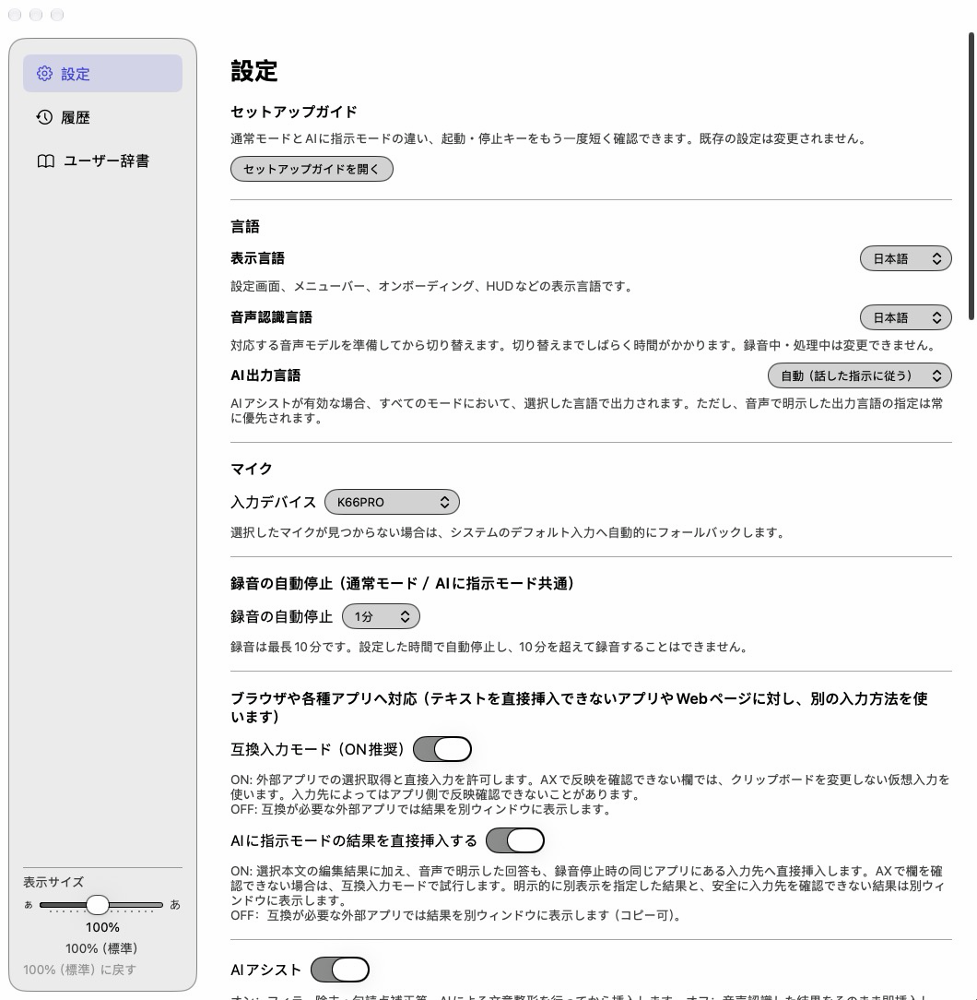

# ItJustTalks

[English](README.md) · [日本語マニュアル](docs/manual/ja.md) · [English manual](docs/manual/en.md)

ItJustTalks 0.1.0 は、macOS 27用の完全無料・完全ローカルの音声入力＆文章アシスタントです。声を文字にして整え、選択した文章やコピーした文章の校正・翻訳・要約、文章作成を手伝います。同じ開発者のKoedexから派生したApache-2.0のアプリで、AIにはApple Foundation Modelsのオンデバイスモデルだけを使います。外部AIの契約やAPIキーは不要です。

<p align="center">
  
  
</p>

## 4つの使い方

| 使い方 | 操作と内容（キーは初期値） |
| --- | --- |
| 通常音声入力＋AI整形 | `fn`で開始・停止。文字起こしからフィラーを除き、句読点を整えて入力します |
| AIに指示 | `fn＋Space`で開始、`fn`で停止。選択文章を編集したり、選択なしで質問・文章作成を頼めます |
| クリップボードモード | 有効化後、Optionを先に押しながら`fn＋Space`。コピーした本文に音声で指示します。初期状態はOFFです |
| ハンズフリー送信 | 有効化後、`fn＋右Shift`で開始・停止。音声の合図でも停止できます。条件を満たす時だけ入力後に送信キーを押します。初期状態はOFFです |

自動停止や録音表示（HUD）の停止ボタンでは送信しません。通常用・AIに指示用の2種類のカスタム指示とAI最適化、ユーザー辞書、履歴も利用できます。詳しくは[6章](docs/manual/ja.md#chapter-6)・[8章](docs/manual/ja.md#chapter-8)を参照してください。

## このMacにとどまるもの

文字起こし、AI整形、AIに指示、クリップボード本文の処理、カスタム指示のAI最適化はMac内で行います。Codex・ChatGPT・OpenAIは使用せず、Web検索や外部AI・Private Cloud Computeへの切替もありません。

**メールやチャットに入力した文章は、入力先アプリ自身の通信で外部へ送られます。** ハンズフリー送信も同じです。ローカルAI処理は、入力先アプリの送信や同期を止めるものではありません。

処理のために通信しない設計です。Apple Intelligence・音声認識モデルの取得やOS更新にはOS側の接続が必要な場合があります。Universal Clipboard、他社のクリップボード履歴、バックアップや同期は、それぞれの設定に従います。

## 動作要件と既知の制約

| 項目 | 条件・確認状況 |
| --- | --- |
| OS | macOS 27以降。オンデバイスAIは macOS 27 で追加された Apple Foundation Models の機能を使うため、パッケージ・アプリ・事前確認スクリプトのすべてで27以上を必須にしています |
| AI | Apple Silicon、Apple Intelligence有効、オンデバイスモデルの準備が必要。**MacとSiriの言語を、Apple Intelligenceの同じ対応言語にそろえてください。** 言語が違うとAIは使えません。システム設定の「一般」→「言語と地域」と「Apple IntelligenceとSiri」（表示によっては「Siri」）で確認できます。言語を変えると、準備に時間がかかることがあります。実際の利用可否はそのMacの状態表示で確認します |
| メモリ・機種 | 最小RAM・チップ世代別の保証はありません。Apple M5 Max（メモリ64GB）で確認。M1（メモリ8GB）は確認予定 |
| Core 3搭載Mac | **未確認**です |
| 言語 | 表示・音声認識は日本語／英語。AI出力は自動／日本語／英語。音声で指定した出力言語が優先されます。その他のAI言語の対応・品質は保証しません |
| 権限 | マイク・音声認識・アクセシビリティ。直接入力できないアプリでは結果ウィンドウからコピーします |

- 録音は1・3・5・10分で自動停止（初期値5分、最長10分）。選択・コピーした本文は12,000文字までです。文字起こしに一律の文字数上限は確認できていません。
- AIの容量はモデルと指示・辞書等で変わります。通常整形は最大8区間、AIに指示は統合段階を含め16枠まで分割します。質問回答・返信は分割しません。超過分を黙って切り捨てたり、成功した区間だけを自動入力したりしません。
- 不確実な生成結果は自動置換・自動送信しません。通常音声入力ではAI未準備・失敗・時間切れ・分割不能時に**全文の未整形原文（辞書の語が当てはまる時は、辞書の表記だけを反映した文）を入力して通知する場合があります**。要確認の結果、不完全な録音（音声認識のエラー・末尾の未確定・音声データの欠落）、音声認識の確定失敗は確認用の結果ウィンドウに表示し、自動では入力も送信もしません。
- AIアシストONのハンズフリーは、整形失敗・部分成功・要確認で自動挿入も送信も止めます。最初からAIアシストOFFなら原文入力と条件付き送信ができます。
- 通常音声入力とハンズフリーは、録音を止めた時点で入力先を取り直します。録音中に同じアプリ内の別の欄へ移った場合は、移った先の現在位置へ入力されることがあります（互換入力を含む、できる範囲の動作）。AIに指示は元の選択に結び付いており、選択や入力先が合わなければ結果ウィンドウに表示します。ハンズフリーの送信は、より厳しい条件を別に確認します。挿入結果が不明でも自動で再貼り付け・再送しません。
- AIは言い回しを縮めたり、長い口述の一部を取りこぼしたりすることがあります。長文の翻訳・要約は分割しても失敗する場合があります。検査はすべての誤りを検出できません。大切な文章や数字を確認してください。

詳細は[3章：動作要件と既知の制約](docs/manual/ja.md#chapter-3)、問題の切り分けは[13章](docs/manual/ja.md#chapter-13)へ。

## インストール・更新

配布方式はソースビルド＋このMacの自己署名証明書です。Git、macOS 27対応の開発ツール（Swift 6.4以上とmacOS 27のSDK）、証明書作成用のOpenSSL 3が必要です。事前確認のSwift 6.4以上判定だけでSDK互換性は保証しません。

ソースはZIPダウンロードではなく、`git clone https://github.com/GrShin5/ItJustTalks`で取得してください。Desktop・Documents・iCloud Drive・File Providerの配下を避け、例えば`~/Developer/ItJustTalks`に配置します。条件を満たさないと事前確認が失敗し、ビルドも停止します。

[付録Bの準備と注意事項](docs/manual/ja.md#appendix-b)を読んだうえで、ソースの作業フォルダで順番に実行します。証明書の作成・キーチェーン登録と認証は内容を確認してください。

```sh
bash scripts/preflight.sh
bash scripts/make_signing_cert.sh
bash scripts/make_app.sh release
bash scripts/verify_app_identity.sh dist/ItJustTalks.app
bash scripts/preflight.sh --install
bash scripts/install_app.sh
```

エラー時は停止してください。既存の有効な署名は再利用し、検証を省略しません。インストール用スクリプトは既存アプリを上書きしません。導入は[導入プロンプト](docs/agent-install-prompt.md)と[付録A](docs/manual/ja.md#appendix-a)、更新は[更新プロンプト](docs/agent-update-prompt.md)と[付録D](docs/manual/ja.md#appendix-d)でも案内しています。AIエージェントはアプリの通常利用には不要です。

## プライバシー

設定・辞書・履歴はItJustTalks独立のローカル保存先を使い、Koedexのデータを自動移行しません。録音音声ファイルは保存しません。履歴は各モード180日保存が初期値で、「履歴」タブから停止・削除できます。通常・ハンズフリーは保存条件を満たす出力、AIに指示・クリップボードは音声指示の文字起こしを保存し、対象本文や回答は保存しません。本文を含まない処理情報が残る場合があります。詳しくは[12章](docs/manual/ja.md#chapter-12)、報告方法は[SECURITY.md](SECURITY.md)へ。

## AI整形・回答の精度を重視する方へ：Koedex

同じ開発者による [Koedex](https://github.com/GrShin5/Koedex) は、ItJustTalksの元になったmacOS用の音声入力アプリです。文字起こしはItJustTalksと同じくMacの中で行い、AI整形と「AIに指示」は、Macに入れたOpenAI製のツール（Codex CLI）の Codex App Server を通じて、OpenAIのモデルで処理します。そのため、AI整形や回答の精度はItJustTalksより高くなることが期待できます。その代わり、文字起こしした文章（音声は含みません）がOpenAIへ送られ、ChatGPTのサブスクリプションとCodex CLIが必要です（macOS 26以降）。完全ローカル・無料を重視するならItJustTalks、出力精度を重視するならKoedex、と使い分けてください。KoedexはOpenAIとは関係のない、独立した個人プロジェクトです。

## ライセンスと帰属

Koedex（Copyright 2026 GrShin5）から派生しています。[Apache License 2.0](LICENSE)で提供し、帰属表示は[NOTICE](NOTICE)を参照してください。

Apple、macOS、Apple IntelligenceはApple Inc.の商標です。本プロジェクトはAppleと提携していません。
