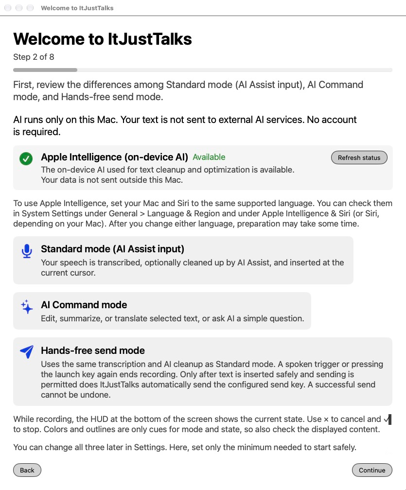
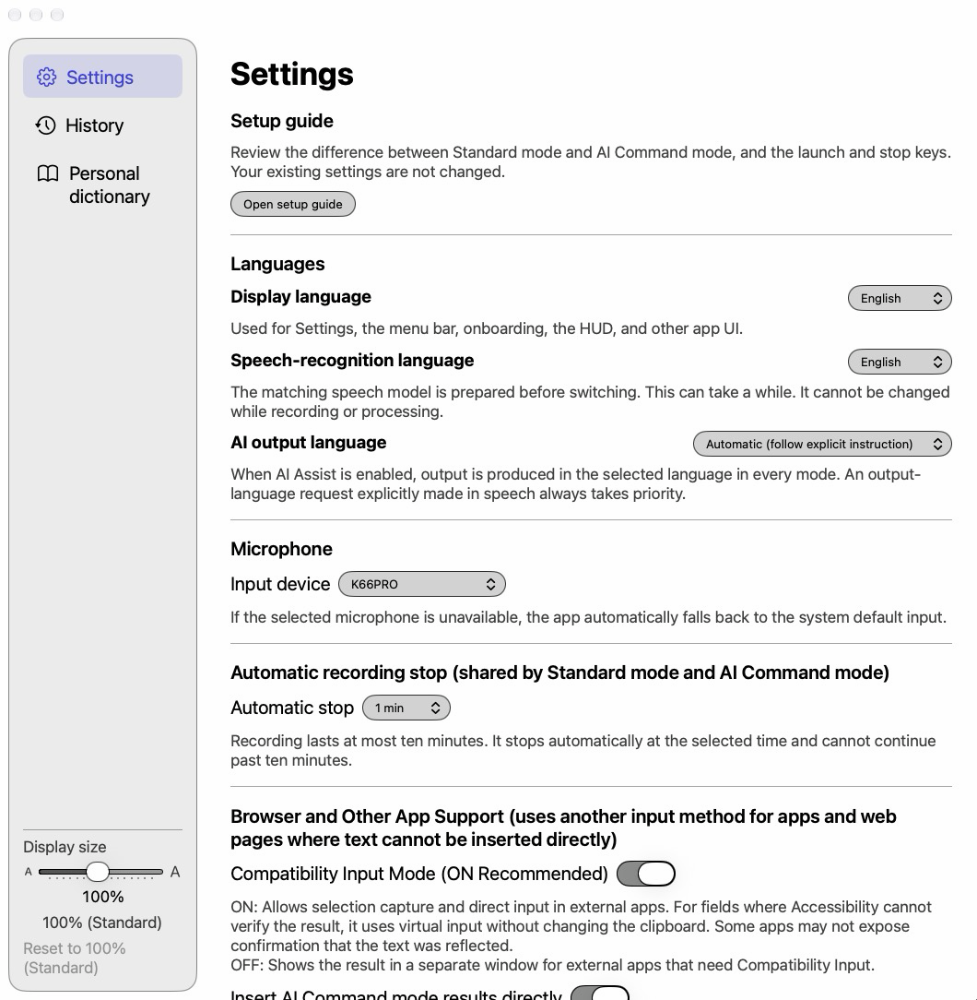

# ItJustTalks

[日本語](README.ja.md) · [Japanese manual](docs/manual/ja.md) · [English manual](docs/manual/en.md)

ItJustTalks 0.1.0 is a completely free, fully local voice input and writing assistant for macOS 27. It transcribes and cleans up speech, edits, translates or summarizes selected or copied text, and helps draft writing. Derived from Koedex by the same developer and licensed under Apache-2.0, it uses only the on-device model in Apple Foundation Models. No external AI subscription or API key is required.

<p align="center">
  
  
</p>

## Four ways to use it

| Mode | Operation and purpose (default keys) |
| --- | --- |
| Voice input + AI cleanup | Press `fn` to start and stop. Remove fillers and adjust punctuation before inserting the transcript |
| AI Command | Start with `fn + Space`, stop with `fn`. Edit selected text, or ask questions and draft text without a selection |
| Clipboard mode | After enabling it, hold Option first, then press `fn + Space`. Give spoken instructions about copied text. Off by default |
| Hands-free send | After enabling it, use `fn + Right Shift` to start and stop, or stop with the spoken trigger. Press the send key after insertion only when the conditions are met. Off by default |

Automatic stop and the recording display's (HUD) stop button do not send. Separate custom instructions for ordinary input and AI Command, AI instruction optimization, a personal dictionary, and history are also available. See [Chapter 6](docs/manual/en.md#chapter-6) and [Chapter 8](docs/manual/en.md#chapter-8).

## What stays on this Mac

Transcription, AI cleanup, AI Command, clipboard text processing, and custom instruction optimization run on this Mac. The app does not use Codex, ChatGPT, or OpenAI, perform web searches, or switch to external AI or Private Cloud Compute.

**Text entered in mail or chat is sent externally by the target app's own network activity.** This also applies to hands-free send. Local AI processing does not stop the target app from sending or syncing text.

The app is designed not to communicate over the network for its processing. Apple Intelligence and speech-model downloads and OS updates may require OS network access. Universal Clipboard, other clipboard history tools, backups, and synchronization follow their own settings.

## Requirements and known limitations

| Item | Requirement or verification status |
| --- | --- |
| OS | macOS 27 or later. The on-device AI uses Apple Foundation Models APIs that first appear in macOS 27, so the package, the app and the preflight check all require 27 |
| AI | Apple Silicon, Apple Intelligence enabled, and an on-device model ready. **Your Mac and Siri must use the same language supported by Apple Intelligence**; AI does not work if they differ. Check them in System Settings under General > Language & Region and under Apple Intelligence & Siri (or Siri, depending on your Mac). Preparation may take some time after you change either language. Check availability on the actual Mac |
| Memory and hardware | No minimum RAM or chip-by-chip guarantee. Verified on Apple M5 Max (64GB memory). M1 (8GB) is planned. |
| Core 3 Macs | **Unverified** |
| Languages | UI and speech recognition: Japanese / English. AI output: Automatic / Japanese / English; an explicitly spoken output language takes priority. Other AI languages and their quality are not guaranteed |
| Permissions | Microphone, Speech Recognition, Accessibility. For apps that cannot accept direct insertion, copy from the result window |

- Recording stops automatically after 1, 3, 5, or 10 minutes (default 5, maximum 10). Selected or copied text is limited to 12,000 characters. No universal character limit for speech transcripts has been established.
- AI capacity depends on the model, instructions, dictionary, and other overhead. Cleanup can split into up to 8 chunks; AI Command allows up to 16 slots including integration. Questions and replies are not split. Excess text is not silently truncated, and successful chunks alone are not automatically inserted.
- Uncertain generated results are not automatically used to replace or send text. Ordinary dictation may **insert the entire unedited transcript (or, when a dictionary term applies, the transcript with only dictionary spellings applied) and notify you** when AI is unavailable, fails, times out, or cannot split the text. Results needing review, incomplete recordings (a recognition error, an unfinalized tail, or lost audio), and speech-finalization failures go to the result window for review; nothing is inserted or sent automatically.
- With AI assist on, hands-free cleanup failure, partial success, or review status stops automatic insertion and sending. With AI assist off from the start, the original transcript can be inserted and sent if send conditions are met.
- Standard dictation and hands-free read the input target again when recording stops. If you moved to another field in the same app during recording, the text may be inserted at the caret there (best effort, including Compatibility Input). AI Command stays bound to the original selection and shows the result window instead if the selection or target no longer matches. Hands-free sending applies its own stricter checks. An uncertain insertion does not trigger automatic repasting or resending.
- AI may shorten wording or omit parts of long dictation. Long translations and summaries can fail even after splitting. Validation cannot catch every error; check important text and numbers.

See [Chapter 3: Requirements and known limitations](docs/manual/en.md#chapter-3) and [Chapter 13: Troubleshooting](docs/manual/en.md#chapter-13).

## Install and update

Distribution is by building from source and signing with a self-signed certificate on this Mac. Git, development tools supporting macOS 27 (Swift 6.4 or later with the macOS 27 SDK), OpenSSL 3 for certificate creation (for example, `brew install openssl@3` with Homebrew), and an account that can write to the Applications folder (normally an administrator account) are required. Preflight's Swift 6.4 minimum does not guarantee SDK compatibility.

Get the source with `git clone https://github.com/GrShin5/ItJustTalks`, not a ZIP download. Keep it outside Desktop, Documents, iCloud Drive, and File Provider storage, for example at `~/Developer/ItJustTalks`. Otherwise preflight fails and the build stops.

Read [Appendix B's preparation and cautions](docs/manual/en.md#appendix-b), then run these commands in the source folder in order. Review certificate creation, Keychain registration, and authentication before approving them.

```sh
bash scripts/preflight.sh
bash scripts/make_signing_cert.sh
bash scripts/make_app.sh release
bash scripts/verify_app_identity.sh dist/ItJustTalks.app
bash scripts/preflight.sh --install
bash scripts/install_app.sh
```

Script messages follow the locale (LC_ALL, LC_MESSAGES, or LANG) and are in Japanese when it is unset, C, or POSIX; run them with `ITJUSTTALKS_LANG=en` (for example, `ITJUSTTALKS_LANG=en bash scripts/preflight.sh`) to get English output.

Stop on errors. Reuse a valid existing identity and keep verification enabled. The installer does not overwrite an existing app. The [install prompt](docs/agent-install-prompt.en.md) and [Appendix A](docs/manual/en.md#appendix-a), or [update prompt](docs/agent-update-prompt.en.md) and [Appendix D](docs/manual/en.md#appendix-d), provide agent-assisted instructions. To update without an agent, see [Appendix D](docs/manual/en.md#appendix-d). An AI coding agent is not needed for normal app use.

## Privacy

Settings, dictionary, and history use independent local ItJustTalks storage; Koedex data is not automatically migrated. Audio recordings are not saved as files. History defaults to 180 days per mode and can be disabled or deleted in the History tab. Ordinary and hands-free modes store output that meets their saving conditions. AI Command and clipboard mode store only the spoken instruction transcript, not the target text or answer. Content-free processing information may remain. See [Chapter 12](docs/manual/en.md#chapter-12) and [SECURITY.md](SECURITY.md) for reporting.

## Want more accurate AI cleanup and answers? Try Koedex

[Koedex](https://github.com/GrShin5/Koedex), by the same developer, is the macOS voice input app that ItJustTalks was derived from. Like ItJustTalks, it transcribes on your Mac. AI cleanup and AI commands run on OpenAI models through the Codex App Server of the Codex CLI, an OpenAI tool installed on your Mac, so you can expect more accurate AI cleanup and answers than ItJustTalks. In exchange, the transcribed text (not audio) is sent to OpenAI, and it requires a ChatGPT subscription and the Codex CLI (macOS 26 or later). Choose ItJustTalks if you want fully local and free, or Koedex if the accuracy of AI cleanup and answers matters most. Koedex is an independent personal project and is not affiliated with OpenAI.

## License and attribution

Derived from Koedex (Copyright 2026 GrShin5). Distributed under the [Apache License 2.0](LICENSE); see [NOTICE](NOTICE) for attribution.

Apple, macOS, and Apple Intelligence are trademarks of Apple Inc. This project is not affiliated with Apple. Other product and company names are trademarks of their respective owners.
