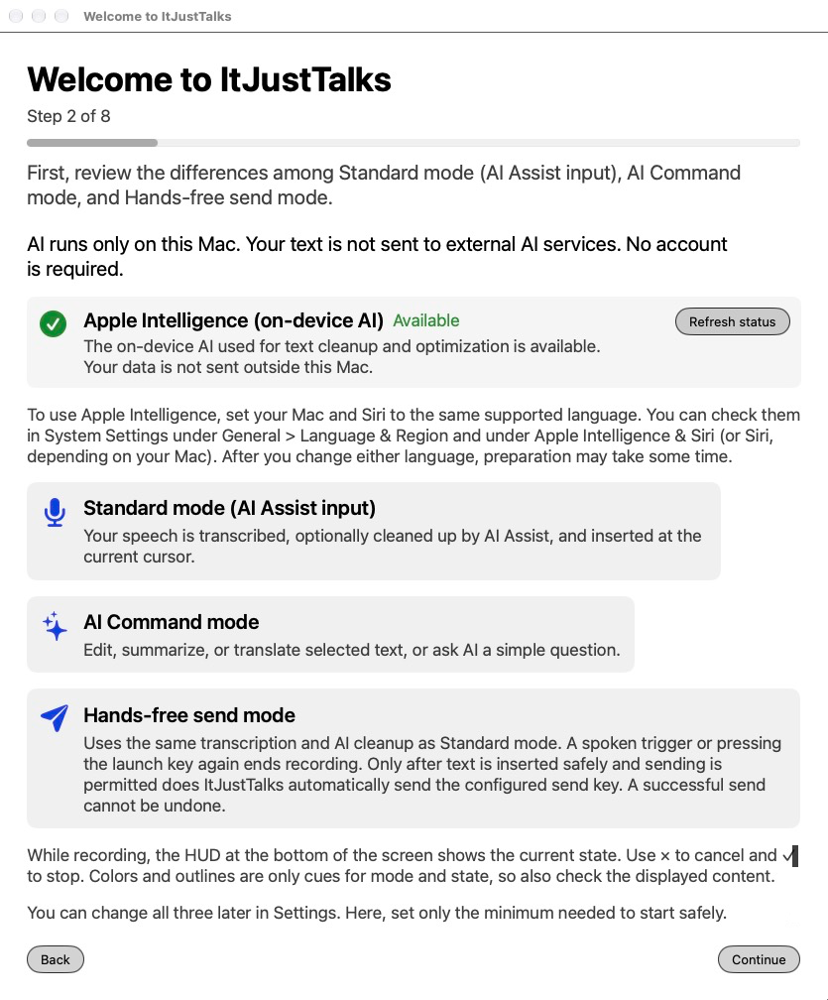
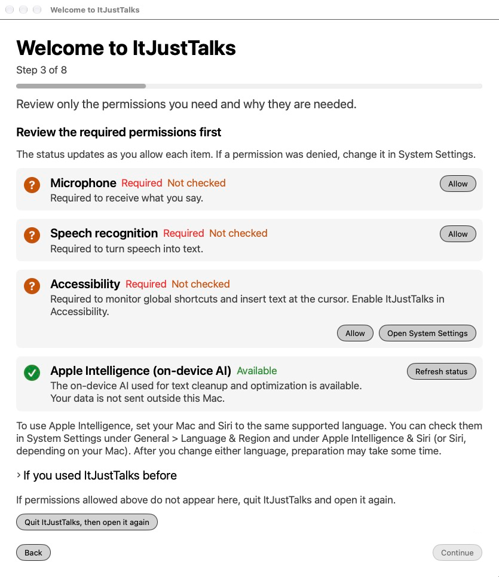
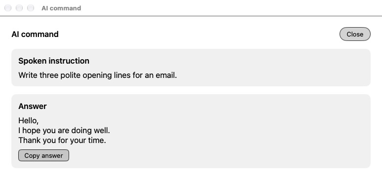
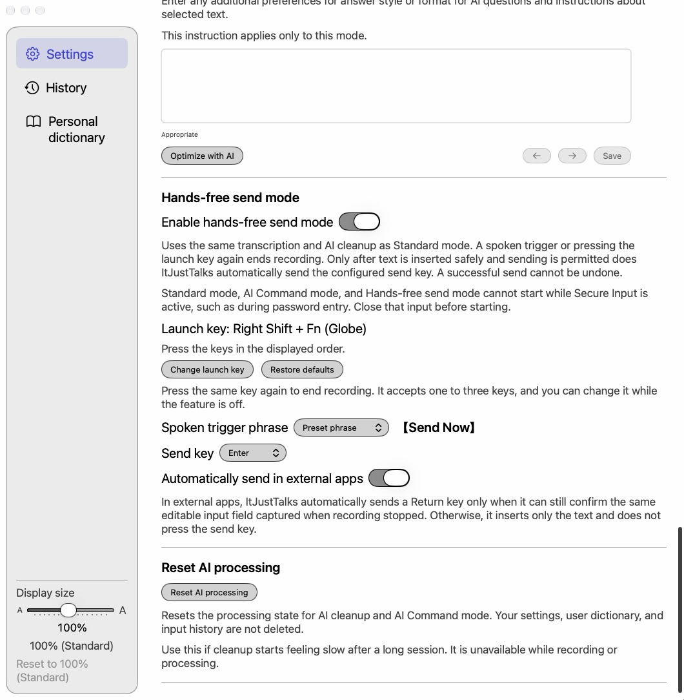
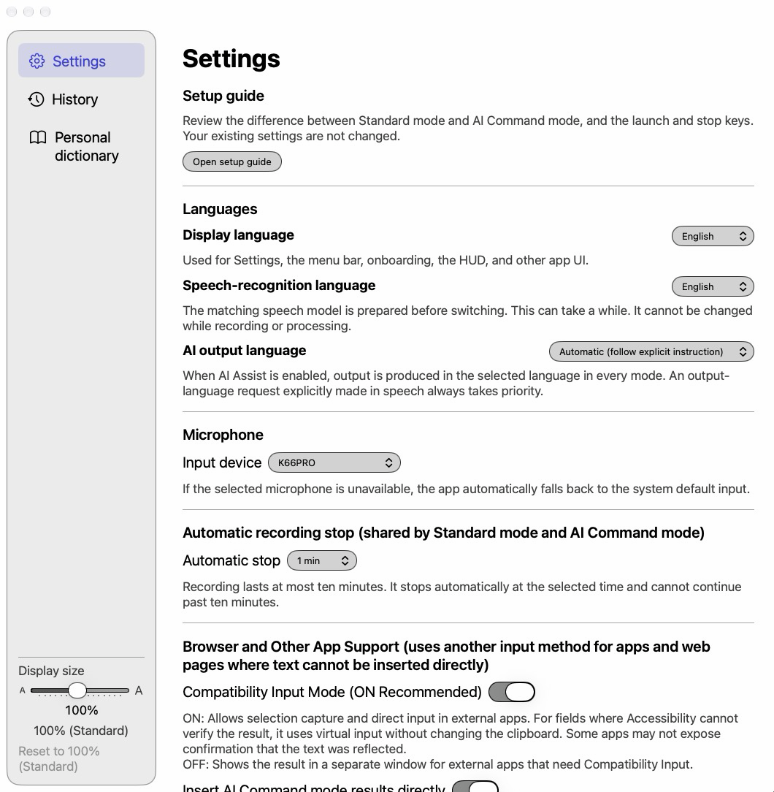
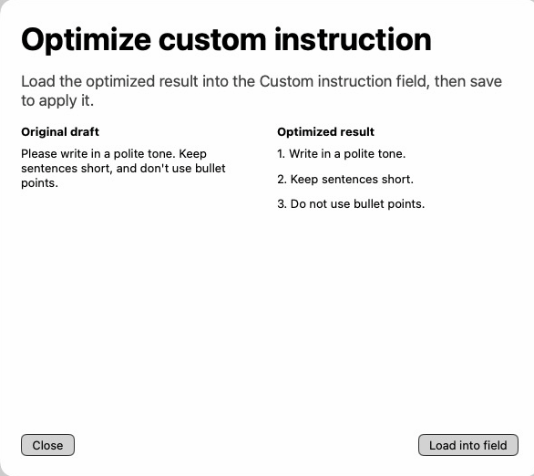
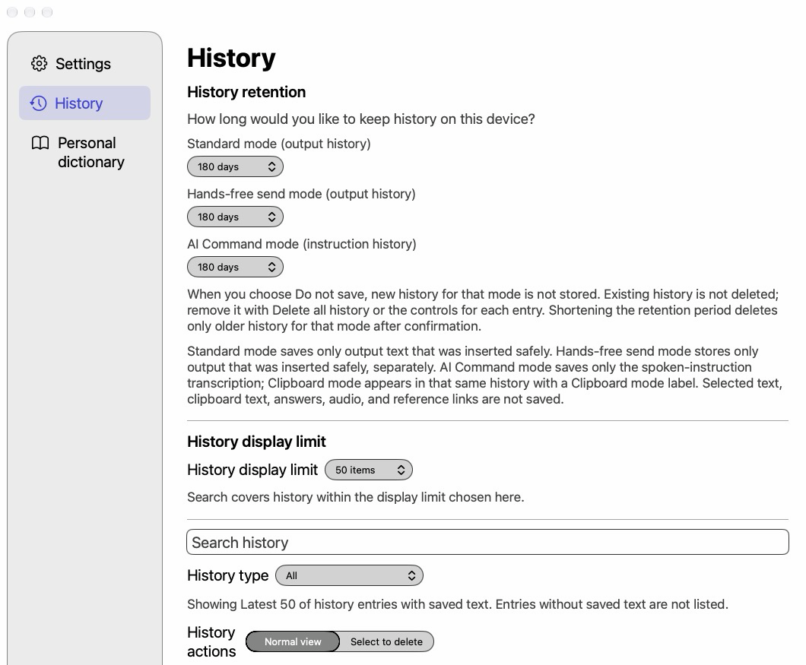
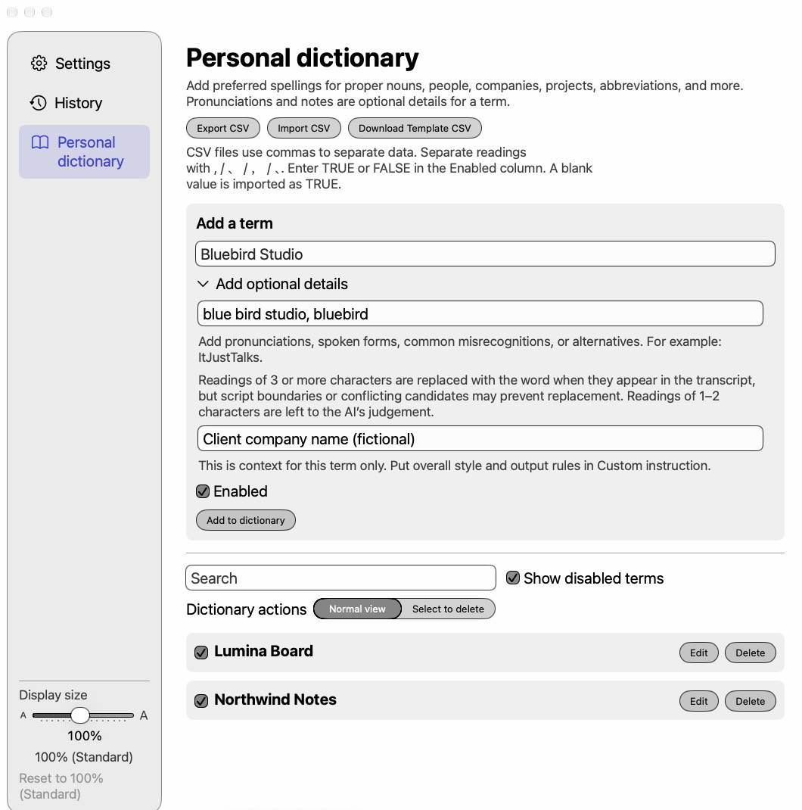
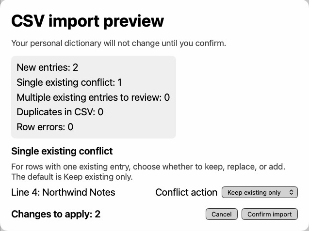
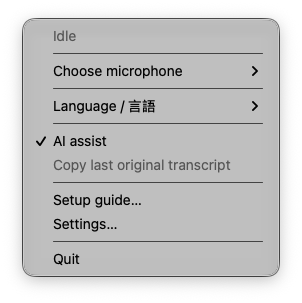

# ItJustTalks User Manual (English)

A guide to turning speech into text, cleaning up writing, and rewriting text on your Mac.

## Contents

1. [Introduction](#chapter-1)
2. [Get started in five minutes](#chapter-2)
3. [Requirements and known limitations](#chapter-3)
4. [Getting and installing the app](#chapter-4)
5. [First-time setup](#chapter-5)
6. [Four ways to use ItJustTalks](#chapter-6)
7. [Settings reference](#chapter-7)
8. [Custom instructions and AI optimization](#chapter-8)
9. [History](#chapter-9)
10. [Personal dictionary](#chapter-10)
11. [Menu bar](#chapter-11)
12. [Privacy and data](#chapter-12)
13. [Troubleshooting](#chapter-13)
14. [Frequently asked questions](#chapter-14)
15. [Glossary](#chapter-15)
16. [Uninstalling](#chapter-16)

- [Appendix A: Installation with an AI agent](#appendix-a)
- [Appendix B: Building from source yourself](#appendix-b)
- [Appendix C: Version and distribution covered by this manual](#appendix-c)
- [Appendix D: Updating with an AI agent](#appendix-d)
- [Appendix E: Moving from or using Koedex alongside ItJustTalks](#appendix-e)

<a id="chapter-1"></a>
## 1. Introduction

### What is ItJustTalks?

ItJustTalks is a free voice input and writing assistant for macOS. It can transcribe and insert what you say, or use AI to edit selected text. Some apps do not support direct insertion; in those apps, copy the text from the result window.

| Way to use it | What it does |
| --- | --- |
| Voice input and AI cleanup | Transcribes speech, removes fillers such as “um,” adjusts punctuation, and inserts the text |
| AI Command | Proofreads, translates, or summarizes selected text; answers questions and drafts writing |
| Clipboard mode | Takes your instructions about text you have copied yourself |
| Hands-free send | Inserts your speech, then presses the send key when the required conditions are met. Off by default |

ItJustTalks is derived from Koedex and includes its software under Apache-2.0.

### What “AI runs only on this Mac” means

Transcription, AI cleanup, AI Command, clipboard text processing, and AI optimization of custom instructions all run on your device. AI uses only the on-device model in Apple Foundation Models. Your input is not sent to an AI cloud or a private server. The app does not use Codex, ChatGPT, or OpenAI services, and does not switch to external AI or Private Cloud Compute.

**Text entered in mail or chat is sent outside your Mac by the target app's own network activity.** The same applies to hands-free send. Local AI processing does not mean that the destination of your message stays on your Mac.

Apple Intelligence and speech-recognition model downloads, and OS updates, may need an internet connection through the OS. The app is designed not to communicate over the network for its processing. Offline use may not be available from the first launch.

Universal Clipboard, other clipboard history tools, OS diagnostics, backups, and exports to synced locations follow their own settings and behavior. ItJustTalks cannot stop all syncing or network activity on its own.

### Cost

There is no purchase price, subscription, usage charge, or paid feature unlock for the app's covered features. No external AI subscription or API key is needed. This does not make your Mac, electricity, or the environment needed to download models free.

<a id="chapter-2"></a>
## 2. Get started in five minutes

Once the app is installed and the models are ready, try a short sentence. “Five minutes” is a guide to starting use, not a promise about build or download times.

1. Check the [requirements](#chapter-3) and [install the app](#chapter-4).
2. Open ItJustTalks and allow microphone, speech recognition, and accessibility access during [first-time setup](#chapter-5).
3. Check that the microphone picks up your voice and the launch key responds.
4. Click a text field, such as one in Notes, and press `fn` (globe) once.
5. Say a short sentence, then press `fn` again. The text is inserted after processing.
6. Read the inserted text and check names and numbers.


Even when AI is unavailable, Standard mode can insert the unedited transcript (or, when a dictionary term applies, the transcript with only dictionary spellings applied) if speech recognition succeeds. Check “Apple Intelligence (on-device AI)” in Settings for AI availability.

If the key does not respond, check accessibility permission. If there is no audio input, check microphone permission and the input device. If `fn` also activates a macOS feature, follow the setup guidance to check keyboard settings.

If you do not want history saved, choose “Do not save” for each mode in the “History” tab before using the app. Each mode defaults to 180 days of history.

<a id="chapter-3"></a>
## 3. Requirements and known limitations

### Environment and languages

| Item | Requirement or supported range |
| --- | --- |
| OS | macOS 27 or later is required. The on-device AI uses Apple Foundation Models APIs that first appear in macOS 27. The package, the app's Info.plist and the preflight check all require 27 or later |
| AI | Requires Apple Silicon and an environment that supports Apple Intelligence. Actual availability depends on the on-device model status shown on that Mac |
| Mac and Siri language | **Must be set to the same supported language.** AI does not work if they differ. Check them in System Settings under General > Language & Region and under Apple Intelligence & Siri (or Siri, depending on your Mac) |
| Memory and chip | A minimum memory amount and a list of supported chip generations have not been established. Operation on every Apple Silicon Mac is not guaranteed |
| Speech-recognition languages | Japanese and English. Speech-recognition support is also checked at runtime |
| Display languages | Japanese and English, selectable separately from the speech-recognition language |
| AI output languages | Automatic, Japanese, and English. An output language explicitly requested by voice takes priority over the setting |
| Other AI languages | A complete list of supported languages and their quality cannot be guaranteed. This is separate from speech-recognition support |
| Verification | Verified on Apple M5 Max (64GB memory). M1 (8GB) is planned. |
| Core 3 Macs | Unverified. Operation is not claimed |

Voice input and transcription may work even if AI is unsupported. Speech recognition must have its own support and permissions.

### AI readiness

Apple requires your Mac and Siri to use the same supported language for Apple Intelligence. The ItJustTalks display, speech-recognition, and AI output languages can be chosen separately. After you change your Mac or Siri language, AI may be temporarily unavailable until the new language is ready. While the languages differ, System Settings may show “Siri” instead of “Apple Intelligence & Siri”, with a notice about the language.

| Display | What to check |
| --- | --- |
| Available | On-device AI is available on this Mac |
| Apple Intelligence is turned off | Turn it on in “Apple Intelligence & Siri” in System Settings. If that item is missing, set your Mac and Siri to the same language |
| This Mac is not supported | AI cleanup and other AI features are unavailable. Speech-recognition availability is separate |
| The model is being prepared | Make sure your Mac and Siri use the same language. If they do, wait for downloading or preparation to finish, then press “Refresh status” |
| Unavailable | The status is unknown, or AI is unavailable because of the OS or other conditions |

### When AI is unavailable or processing fails

The hands-free column below assumes AI assist was ON when recording began.

| State | Standard voice input | AI Command / Clipboard mode | Hands-free send | AI instruction optimization |
| --- | --- | --- | --- | --- |
| AI available | Inserts after cleanup and validation | Replaces text or displays a result after generation and validation | Inserts and sends only when cleanup and send conditions are met | Previews a candidate |
| AI not ready, disabled, or unsupported | Inserts the original transcript and notifies you if recognition succeeds | Explains the reason; does not replace text | Displays the original transcript; does not insert or send | Shows guidance; keeps the current setting |
| Language unsupported by AI | Usually inserts the original transcript and explains why | Explains the reason; does not replace text | Displays the original transcript; does not send | Keeps the draft and reports failure |
| Text too long | Tries splitting; if that is not possible, inserts the entire original transcript and notifies you | Splits as appropriate for the request; otherwise asks you to narrow the scope | Does not insert or send unless every chunk succeeds | Splits and combines; otherwise asks you to edit |
| AI refusal or invalid result | Inserts the original transcript and notifies you on failure; displays results needing review | Does not replace automatically | Does not insert or send automatically | Does not apply a candidate that fails validation |
| AI timeout or cancellation | On AI timeout, inserts the original transcript. On cancellation, discards the result and temporarily keeps a recoverable original transcript | Discards the result or reports failure; preserves the original selection | Does not send | Keeps the current setting |
| Speech finalization times out or is empty | Shows interim text or other results for review; does not insert automatically | Does not carry out the instruction; preserves the original selection | Does not send | Not applicable |
| Audio capture or recognition incomplete | Shows all available text for review; does not insert automatically | Does not carry out the instruction; preserves the original selection | Neither inserts nor sends | Not applicable |
| Target or selection changed | Inserts into the target read again when recording stops; a different field in the same app may receive it at the caret | Stops automatic replacement and displays the result if it no longer matches the original selection | Inserts as in Standard; does not send unless the stricter conditions are met | Not applicable |
| Insertion uncertain | Moves to review without automatically pasting again | Offers manual copying from the result window | Does not resend automatically | Not applicable |

**AI failure in Standard mode does not mean that nothing is inserted.** The unedited original transcript may be inserted. However, if AI cleanup fails in Standard mode and dictionary terms apply, the app inserts the transcript with only the dictionary spellings applied and notifies you: “AI cleanup could not be used, so the text was entered with only your dictionary spellings applied. The original is available from "Copy last original transcript" in the menu.” The reason AI could not be used follows. When no dictionary term applies, the unedited original transcript is inserted and you are notified: “AI cleanup could not be used, so the original text was entered without cleanup.” “Inserts the original transcript” in the table above means the dictionary-spellings-only text whenever a dictionary term applies. If AI assist was OFF from the start in hands-free mode, the original transcript can be inserted and sent when send conditions are met.

If the language is not supported for AI processing, the notice reads “This language is not supported for AI processing.” followed by “AI processing supports Japanese and English.”

**When audio capture or recognition is incomplete, nothing is inserted or sent automatically.** This applies when speech recognition ended with an error, a recognized tail was never finalized, or some audio was lost. All available text is shown in the result window with this notice: “Audio capture or recognition was incomplete, so automatic processing was stopped. All available text is shown. Review it and copy it as needed.” The notice is the same for Standard, hands-free, and AI Command. AI Command does not carry out the instruction and leaves your selected text untouched. An empty final result is handled like “Speech finalization times out or is empty” in the table above.

**When the AI result may have lost or changed something, it is shown in the result window for review.** Examples are a dropped sentence or phrase, a dropped hedge or condition (such as “たぶん”, “もし”, “maybe”, or “only”), a number missing from one of two facts, a negation moved to a different subject, and untranslated output when the target language is Chinese, Korean, or Japanese. The text is not replaced automatically, and hands-free mode neither inserts nor sends it. The result is also shown for review when an auxiliary such as “〜しておく”, or a predicate of a different kind (such as a request or a negation), has disappeared. This is judged by comparing with what you said before abandoned restarts were removed. Filler removal and the cleanup of parts you clearly restated remain acceptable.

Automatic application stops for protected fields such as passwords, revoked permissions, cancellation, stale results, or a mismatched selection or target in AI Command. Standard and hands-free read the target again when recording stops, so if you move to another field in the same app during recording, the text may be inserted at the caret there (also with Compatibility Input). Automatic sending to external apps through Compatibility Input requires additional consent. Some paths send after confirming the same editable field, and cannot verify that every app has reflected the inserted text.

### Long-text limits and splitting

| Item | Limit or behavior |
| --- | --- |
| Recording | Automatic stop after 1, 3, 5, or 10 minutes. Default 5 minutes; maximum 10 |
| Selected or copied text | Up to 12,000 characters. Leading and trailing whitespace is excluded for clipboard text. Excess text is not silently truncated |
| Speech transcript | No universal character limit has been established. Recording time and AI capacity are separate limits |
| Amount AI can handle at once | Depends on the runtime model, instructions, dictionary, and space reserved for output. No fixed character or token count is guaranteed |
| Standard cleanup | Splits into up to 8 chunks if needed, combining them after all succeed |
| AI Command | Joins chunks for proofreading, rewriting, and translation; integrates summaries and explanations; merges duplicate extractions. Up to 16 slots including integration. Questions and replies are not split |
| Some Compatibility Input paths | Up to 390 UTF-16 units, which can differ from visible character counts for emoji and other text. Longer results go to the result window. This is not a limit shared by every insertion path |

Splitting uses paragraph and sentence boundaries, but does not guarantee that a number sequence or URL always stays together. If any chunk fails, successful chunks alone are not inserted automatically. Standard mode falls back to the entire unedited transcript (or, when dictionary terms apply, the transcript with only dictionary spellings applied); hands-free mode goes to review.

Regardless of length, only when AI merges two sentences of different kinds (such as a request, a negation, or a wish) and drops one of them, the app splits what you said in two and cleans up each part once more. The result is used only if it passes validation; otherwise it is shown for review. This is not done in hands-free mode. In this case, the result may take longer to appear.

### What to know about quality

Output accuracy is limited by the capabilities of the on-device Apple Foundation Models. Check the text before you send it or use it for anything important.

AI may shorten the original wording. Long translations and summaries may still be inadequate after splitting and result in a failure message. Parts of long dictation may be omitted. Validation cannot detect every error, so check important writing and numbers.

<a id="chapter-4"></a>
## 4. Getting and installing the app

This manual covers building the app from source, signing it with a self-signed certificate on this Mac, and installing it. In the working folder containing source obtained from the distributor, run these commands in order. [Appendix B](#appendix-b) explains preparation and steps in detail.

Get the source with `git clone https://github.com/GrShin5/ItJustTalks`, not a ZIP download. Keep it outside Desktop, Documents, iCloud Drive, and File Provider storage, for example at `~/Developer/ItJustTalks`. Otherwise preflight fails and the build stops.

```sh
bash scripts/make_signing_cert.sh
bash scripts/make_app.sh release
bash scripts/install_app.sh
```

1. `make_signing_cert.sh` creates and registers a signing certificate in the login keychain. Review and approve the authentication dialog for trust settings. An existing valid certificate is reused.
2. `make_app.sh release` runs preflight checks, builds, bundles resources, signs, and verifies the app, producing `dist/ItJustTalks.app`. Without an argument it uses debug, so include `release`.
3. `install_app.sh` places the verified app in the Applications folder. It does not overwrite an existing app or another item with the same name. These steps cannot simply be repeated over an existing installation to update it.

For checks alone, use `bash scripts/preflight.sh`. Before installation, you can also use `bash scripts/preflight.sh --install`. The installer itself does not call preflight.

Certificate creation needs OpenSSL 3, and building needs development tools. Preflight checks for Swift 6.4 or later and other requirements, but passing does not guarantee that macOS 27 AI features can be built. The exact compatible Xcode and Command Line Tools versions have not been verified. Time from first setup to a finished build is not guaranteed either.

Keep the same signature across updates. If a signature mismatch stops the process, read the guidance and keep verification enabled.

<a id="chapter-5"></a>
## 5. First-time setup

First-time setup has the following eight steps. If you have already chosen a language, are restoring permissions, or are viewing the optional guide, only some steps may appear. Use “Continue” to continue and “Back” to return to the previous step.

### Step 1: Language

Choose “日本語” or “English”. The initial choice sets the display and speech-recognition languages; AI output is set to Automatic. You can change each separately later.

### Step 2: Welcome

The screen says: “AI runs only on this Mac. Your text is not sent to external AI services. No account is required.” Read the explanations for “Standard mode (AI Assist input)”, “AI Command mode”, and “Hands-free send mode”. AI Command can edit, summarize, and translate selected text and answer simple questions. The hands-free explanation says it presses the send key only when text can be inserted safely and sending is allowed, and that sending cannot be undone.

Note: the app does not search the web.

“Apple Intelligence (on-device AI)” shows current readiness. Press “Refresh status” to check again. When AI is unavailable, “Open System Settings” opens the Apple Intelligence settings. See [Chapter 3](#chapter-3) for the meaning of each state.

Only Core 3 Macs show this notice: “Operation on this Mac model (Core 3) has not yet been verified. Please let us know if you encounter any problems.” Other Macs do not show it.

During recording, the HUD at the bottom of the screen shows the status. × cancels and ✓ stops recording. Read the display instead of relying on color alone. All three modes can be changed later in Settings.



### Step 3: Permissions

| Permission | Purpose |
| --- | --- |
| Microphone | Records your voice |
| Speech recognition | Turns speech into text on your device |
| Accessibility | Detects launch keys, reads selected text, checks the target, and inserts text |

Follow “Allow” or “Open System Settings” and the guidance in System Settings. Make sure you are allowing the ItJustTalks app you are currently using. This does not add a requirement for separate Input Monitoring or Automation permission.

This screen also has “Apple Intelligence (on-device AI)” and “Refresh status”, plus “Open System Settings” when AI is unavailable. AI readiness is separate from permissions. Voice input and transcription may work without AI if speech recognition is supported and allowed.

Open “If you used ItJustTalks before” for help with old permission records and “Show the current ItJustTalks in Finder”. If allowed permissions do not appear, use “Quit ItJustTalks, then open it again”, confirm quitting, and reopen the app yourself.



### Step 4: Microphone and keys

Choose an “Input device”, press “Check device”, and speak. Once the meter moves, press “Use this device”. This check is not recorded or saved. If the selected microphone is unavailable, the macOS default input is used.

Under “Standard mode launch key settings”, press “Enter key”, press the actual key, review the candidate, and press “Use this key”. The default is `fn`. If you assign a letter or Space, that key is used to launch ItJustTalks and is not sent to the target field. If it overlaps a macOS action, check “Open Keyboard Settings”. If another voice input app uses the same shortcut key, one key press may trigger both apps. Change the shortcut in one of them.

### Step 5: Usage preferences

Under “Basic usage settings”, choose “Automatic stop”. This is shared by Standard mode and AI Command mode. The choices are “3 min”, “5 min (Recommended)”, and “10 min”. If the existing setting is one minute, “1 min (current setting)” also appears. The screen also explains that none of the three modes can start while Secure Input is active.

History is ON from the start, with a default of 180 days for each mode: Standard, hands-free, and AI Command (including Clipboard mode). Choose a retention period under “Standard mode output history”. Standard mode saves output that was safely inserted (the original transcript when AI assist is OFF; not text inserted after AI cleanup failed), along with minimal processing information, on this Mac.

To stop future saving, go to “History” → “History retention” in Settings and choose “Do not save” for each mode. **Existing history is not deleted.** Remove it separately with “Delete all history”, individual deletion, or selected deletion. The screen also shows the storage location.

“Enable hands-free send mode” is optional. The screen explains that enabling it also turns on “Automatically send in external apps” if Compatibility Input Mode is ON. You can turn this off in Settings if you do not need it. Review the launch key, spoken trigger, send key, and the warning that sending cannot be undone. Standard mode custom instructions also apply to hands-free AI cleanup; changes take effect from the next recording. When enabled, you can also choose “Hands-free send mode output history”. Only safely inserted output is saved; send-key-only actions, cancellation, interruption, failure, and text moved to review are not saved.

### Step 6: AI Command

The opening notice explains that the clipboard is read only when you press this mode's launch shortcut. By default, hold `Option` first, then press `fn + Space`. It does not monitor the clipboard continuously.

Hands-free send presses the send key (default Return) only after you stop with the spoken trigger “ストップ送信” (or “Send Now” when speech recognition is English) or the stop shortcut (default `fn + Right Shift`), and only when insertion is safe and sending is allowed. Automatic stop and the HUD's ✓ insert only; they do not send. × cancels.

Choose ON or OFF with “Enable AI Command mode”, then choose a retention period under “AI Command mode instruction history”. Only the spoken instruction transcript is saved. Clipboard mode shares this history setting. The selected source, clipboard text, AI answer, audio, and reference links are not saved. “Do not save” stops only future saving.

When enabled, choose “Enter key” for each of “Launch key” and “Stop key”, press the actual keys, and confirm each with “Use this key”. The default launch shortcut is `fn + Space` and the stop key is `fn`. Launch shortcuts use one to three keys, including a modifier for combinations. The stop key is a single key. A launch key that overlaps the Standard mode or hands-free send mode key cannot be set; the screen says “This launch key is already used by Standard mode or Hands-free send mode. Choose a different key.” (the same rule as in Settings).

If needed, turn on “Enable Clipboard mode”. In apps where selected text cannot be read, copy it yourself, hold the extra key first, then press the launch shortcut. Secure Input, confidential content, ItJustTalks's own output, non-text content, or overly long text can stop the operation before anything is passed to AI. It does not switch to a general question if reading fails. If the keys conflict, change “Extra key” or the launch shortcut in Settings before enabling it.

### Step 7: Practice

Under “Try transcription (optional)”, press “Try transcription”, speak, then press “Stop recording”. No AI cleanup is performed; the result appears only on this screen. It is deleted when Settings closes, is not saved to history or the dictionary, and is not inserted into other apps. Practice is optional; choose “Try later” to continue. Setup can finish even if practice fails.

### Step 8: Complete

“Setup is complete” appears, with a reminder that settings can be changed later. **Target apps such as mail and chat apps send text using their own features and network connections.** ItJustTalks's AI processing does not send text externally, but hands-free send presses the target app's send key.

Choose “Start ItJustTalks” to finish and open Settings. Try a short sentence in a text field. Later, “Open setup guide” opens the guide without resetting existing settings.

<a id="chapter-6"></a>
## 6. Four ways to use ItJustTalks

The keys below are defaults for a new installation. If you changed them, use the keys shown in Settings.

### Standard voice input and AI cleanup

1. Click the field where you want text inserted.
2. Press `fn` and speak once recording starts.
3. Press `fn` again to stop.
4. With AI assist ON, text is inserted after cleanup and validation. With it OFF, the original transcript is inserted.

Change the recording method to “Hold to record” to record while holding the key. AI removes fillers and adjusts punctuation, but cannot guarantee perfect preservation of wording.

Fillers are removed only when the speaker actually hesitated. The targets are “えっと”, “えーと”, “えー”, and “あのー”, plus “um” and “uh” in English. This automatic removal keeps “ええ”, “ううん”, and “うーん” as replies or content. “まあ” and “なんか” are removed only when they also stood alone, set off by pauses, in what you actually said. Words inside quotation marks are not touched. However, AI cleanup itself may still drop these words.

Results needing review, or a changed target, go to the result window. On AI failure, Standard mode may insert the original transcript. The most recent Standard mode original transcript is kept temporarily in memory and can be recovered with “Copy last original transcript” in the menu. It is discarded when the next recording starts or after ten minutes, whichever comes first. This is separate from saved history.

### AI Command

1. Select text to rewrite. For a question or new writing, start without a selection.
2. Press `fn + Space`.
3. Say an instruction such as “Translate this into English” or “Summarize this briefly”.
4. Press `fn` to stop.
5. Valid editing results become candidates for automatic replacement. Answers normally appear in the result window.



Even if you request insertion by voice, such as “Insert it here”, direct insertion requires consent both when recording begins and when insertion takes place. Writing an output destination in the selected text, dictionary, or saved custom instructions does not change where the result goes.

To ask for a reply to the selected text, start your request with “Reply…” or “Write a reply…”, such as “Reply to this” or “Reply politely”. In Japanese, end the request with a reply request, such as 「この文章に返信して」. The suggested reply normally appears in the result window and the selected text is not rewritten. Replies are not split into parts. Adding a tone word such as “politely” does not turn the request into a rewrite; it is still handled as a reply. However, if the request contains a word for fixing the text, such as “fix my draft and reply”, it is not forced to be a reply; AI decides how to handle it.

Consent for Compatibility Input, pasting through the clipboard, and automatic replacement with AI results is valid only when the setting is ON both when recording starts and when the text is entered. Turning a setting ON in the middle of an operation does not apply to that operation. Turning it OFF does apply, and stops the entry.

Automatic replacement stops if the original selection changes or the app cannot confirm an editable field. Copy from the result window instead. You cannot ask it to send messages, save files, or operate other apps. For current information, provide the source text yourself.

In some apps, selected text is captured by briefly using the copy command. If the clipboard changes unexpectedly during that step (more than once), the capture is rejected. In that case your newly copied content is not overwritten by restoring the earlier clipboard content.

### Clipboard mode

Off by default. Turn on “Enable Clipboard mode” in Settings to use it.

1. Copy the text you want processed yourself.
2. Hold the extra key, `Option`, first, then press `fn + Space`.
3. Say an instruction about the copied text and stop with `fn`.
4. Review the result. Depending on direct insertion settings and target checks, it is inserted or shown in the result window.

Either side's extra key works. You can change it to Command or Control. Copied text is limited to 12,000 characters. Non-text content, content that cannot be handled safely, confidential content, or the app's own output may be refused. If reading fails, it does not silently switch to a general question without the text.

Clipboard mode chooses which text goes to AI. Compatibility Input Mode controls how the result is inserted. They are separate settings.

### Hands-free send

Off by default. Before enabling it, check which key sends in the target app. The default send key is Return; you can change it to Command + Return or Control + Return.

1. Enable hands-free send in Settings and check the send key.
2. Click the target field and press `fn + Right Shift`.
3. Speak your text.
4. Say “ストップ送信” for Japanese speech recognition or “Send Now” for English, or press `fn + Right Shift` again.
5. The text, excluding the trigger, is recognized and cleaned up. Insertion and the send key occur only when safety conditions are met.



**Automatic stop at the time limit and the HUD's ✓ do not send.** They request insertion only. Results needing review or AI failures can also stop insertion. If you say only the trigger, the app may press the send key without adding text.

Before sending, the app checks the same input field, permissions, consent, and other conditions. If cleanup fails with AI assist ON, it shows a result for review instead of switching to the original transcript and sending automatically. If AI assist was OFF from the start, it uses the original transcript.

Automatic sending to external apps through Compatibility Input requires the additional “Automatically send in external apps” confirmation. Consent must be valid both at recording start and at sending. It cannot guarantee that every app's inserted text is fully verified.

In hands-free mode, text containing a line break is not entered through a Compatibility Input path whose result cannot be verified (line breaks include special ones such as CRLF and paragraph separators). The result window shows it instead, so you copy it manually. This also applies when recording ends by automatic stop or the HUD's ✓.

The send key's meaning depends on the target app. When mail or chat actually sends text, that app uses its own network connection.

### Canceling or dealing with uncertain insertion

Use the HUD's × to cancel recording or processing. Late AI results from a canceled operation are not inserted. If insertion is uncertain, the app does not paste or send again automatically; it shows the result. Before copying it, check that the same text is not already in the target field.

<a id="chapter-7"></a>
## 7. Settings reference

The tabs are “Settings”, “History”, and “Personal dictionary”. Defaults below are for a new installation and may differ from existing settings. “—” means an action such as a button with no stored value. ON means enabled; OFF means disabled.



### Shared display controls

| Label | Default | Meaning |
| --- | --- | --- |
| Display size | 100% | 65–140% in 5% steps; shared by settings, history, and dictionary |
| Reset to 100% (Standard) | — | Restores the standard display scale |

### Settings tab: Basics

| Label | Default | Meaning |
| --- | --- | --- |
| Open setup guide | — | Opens the optional guide without changing existing settings |
| Display language | Japanese | Japanese / English; language of screens, menus, and HUD |
| Speech-recognition language | Japanese | Japanese / English; changes after model preparation. Cannot change while recording or processing |
| AI output language | Automatic (follow explicit instruction) | Automatic / Japanese / English; an explicit spoken request takes priority |
| Input device | Automatic (system default) | Uses the system default if the selected microphone is missing |
| Automatic stop | 5 min | 1 / 3 / 5 / 10 minutes; maximum 10 |
| Compatibility Input Mode (ON Recommended) | ON | Allows compatibility insertion into external apps that the usual accessibility path cannot handle |
| Insert AI Command mode results directly | ON | External-app path for selected-text edits or explicit insertion. Unavailable when Compatibility Input is OFF |
| AI assist | ON | Removes fillers and adjusts punctuation. OFF inserts the recognized text directly |
| Apple Intelligence (on-device AI) | Runtime status | Shows AI availability; see Chapter 3 |
| Refresh status | — | Checks Apple Intelligence status again |
| Reset AI processing | — | Recreates internal AI processing state. Does not delete settings, dictionary, or history. Unavailable during recording or processing |

### Settings tab: Standard voice input

| Label | Default | Meaning |
| --- | --- | --- |
| Change launch key | fn | Changes Standard mode's single key by capturing a keypress |
| Recording method | Tap once to start, then tap again to stop | Tap to start/stop, or hold to record |
| Open Keyboard Settings | — | Opens macOS keyboard settings for fn use |
| Custom instruction (Standard mode / Hands-free send mode) | Empty | Writing style and format preferences, with length display |

### Settings tab: AI Command and Clipboard mode

| Label | Default | Meaning |
| --- | --- | --- |
| AI Command mode | ON | When disabled, does not monitor AI Command hotkeys; key controls are also unavailable |
| Change launch key | fn + Space | One to three keys; combinations require a modifier |
| Change stop key | fn | A single key |
| Enable Clipboard mode | OFF | Uses copied text instead of a selection. Independent of Compatibility Input |
| Extra key | Option | Option / Command / Control; checks for conflicts and usable combinations |
| Restore defaults | — | Restores default AI Command keys |
| Custom instruction (AI Command mode) | Empty | Style and format preferences only for AI Command, with length display |

### Settings tab: Shared custom instruction controls

| Label | Default | Meaning |
| --- | --- | --- |
| Optimize with AI | — | Generates a candidate from the instructions being edited; does not save immediately |
| Save | — | Saves the edited instructions as the setting to use |
| Cancel | — | Cancels optimization in progress |
| Go back one saved history item | — | Goes to an earlier saved instruction |
| Go forward one saved history item | — | Goes to a later saved instruction |
| Load into field | — | Loads the preview candidate into the editor. Save is required to apply it |
| Close | — | Closes the candidate preview |

### Settings tab: Hands-free send

| Label | Default | Meaning |
| --- | --- | --- |
| Enable hands-free send mode | OFF | Stops with the same launch shortcut or a spoken trigger, then sends conditionally |
| Change launch key | fn + Right Shift | One to three keys. Can be changed while the mode is OFF |
| Restore defaults | — | Restores default hands-free keys |
| Spoken trigger phrase | Preset phrase | Choose preset or custom. Japanese: ストップ送信; English: Send Now |
| Custom phrase | Empty | 4–20 visible character clusters on one line. No quotation marks or phrase identical to the preset. Can be edited and saved |
| Send key | Return | Return / Command + Return / Control + Return |
| Automatically send in external apps | OFF | Consent with an additional confirmation. Available only when Compatibility Input and hands-free send are enabled |

### History tab

| Label | Default | Meaning |
| --- | --- | --- |
| Standard mode (output history) | 180 days; saving ON | Do not save / 1 day / 30 days / 180 days / Unlimited. See [Chapter 9](#chapter-9) for saved content |
| Hands-free send mode (output history) | 180 days; saving ON | Do not save / 1 day / 30 days / 180 days / Unlimited. See [Chapter 9](#chapter-9) for saved content |
| AI Command mode (instruction history) | 180 days; saving ON | Do not save / 1 day / 30 days / 180 days / Unlimited. See [Chapter 9](#chapter-9) for saved content |
| History display limit | 50 items | 50 / 100 / 200 / all; search covers the displayed range |
| Search history | Empty | Searches text |
| History type | All | Standard / hands-free / AI Command / all |
| History actions | Normal view | Normal view / Select to delete |
| Reload history | — | Reloads after invalid or unreadable history |
| Select all | — | Selects the displayed items, or clears selection if selected |
| Delete all selected | — | Deletes selected history after confirmation |
| Delete all except selected | — | Deletes unselected history in the displayed range after confirmation |
| Delete all hidden metadata | — | Deletes processing information with no text body |
| Delete all history | — | Deletes all text and metadata |
| Delete | — | Deletes an individual history item |
| Copy / Copied | — | Usually an icon; text appears on hover or after copying |

### Personal dictionary tab

| Label | Default | Meaning |
| --- | --- | --- |
| Term or spelling (for example: ItJustTalks) | Empty | Preferred spelling; required |
| Add optional details | Collapsed | Expands pronunciation and note fields |
| Pronunciations or spoken forms (separate with , / 、 / ， / ､) | Empty | Pronunciations, misrecognitions, or alternative spellings |
| Note (optional) | Empty | Explanation of the term |
| Enabled | ON | Includes the term among candidates passed to AI. Existing entries can also be enabled or disabled |
| Search | Empty | Filters registered terms |
| Show disabled terms | ON | Also shows disabled terms |
| Dictionary actions | Normal view | Normal view / Select to delete |
| Export CSV | — | Saves the dictionary to CSV |
| Import CSV | — | Checks a CSV and opens a preview of the import |
| Download Template CSV | — | Saves a template CSV |
| Return to new entry | — | Ends editing and returns to the new-entry form |
| Add to dictionary | — | Registers the entered term |
| Save changes | — | Saves edits |
| Cancel | — | Discards edits in progress |
| Select all | — | Selects all displayed items or clears selection |
| Delete all selected | — | Deletes selected dictionary entries after confirmation |
| Delete all except selected | — | Deletes displayed, unselected dictionary entries after confirmation |
| Edit | — | Opens an existing term in the form |
| Delete | — | Deletes an existing term after confirmation |
| Retry saving the safety backup | — | Tries writing the safety backup again |

### Dictionary CSV import screen

| Label | Default | Meaning |
| --- | --- | --- |
| Confirm import | — | Confirms checked additions and conflict resolutions |
| Cancel | — | Closes the import preview |
| Keep existing only | Keep existing only | Default when an entry overlaps one existing entry; can be changed to replace or add a separate entry |
| Conflict action (Keep existing only / Replace / Add duplicate) | Keep existing only | Import policy for rows whose term overlaps an existing entry |

### Dictionary recovery screen

| Label | Default | Meaning |
| --- | --- | --- |
| Resume dictionary recovery | — | Reopens collapsed recovery controls |
| Rescue verified entries (recommended) | — | Preserves the damaged source and rescues verified entries |
| Restart with an empty dictionary | — | Starts with an empty dictionary after confirmation and backup |
| Retry | — | Parses stored content again |
| Show storage location in Finder | — | Opens the dictionary storage folder |
| Later | — | Collapses recovery controls |

If a usable backup exists, the recovery screen also shows a button with that backup's name. “Copy” is normally an icon, with text on hover or after copying. Arrow buttons move through saved instructions.

“Reset AI processing” does not delete settings, dictionary, or history. Use it when processing will not recover; it is unavailable during recording or processing.

“Do not save” does not delete existing history. Use deletion controls to remove past content. Shortening a retention period deletes only that mode's expired history after confirmation.

CSV import limits are 8 MiB per file, 1,000 data rows, 64 header columns, 100 characters per term, up to 20 pronunciations of 100 characters each, and 500 characters per note. These are not limits on the whole dictionary including manual entries. A total dictionary entry limit has not been established.

<a id="chapter-8"></a>
## 8. Custom instructions and AI optimization

### Two kinds of custom instructions

| Type | Used for | Initial value |
| --- | --- | --- |
| Custom instruction (Standard mode / Hands-free send mode) | Shared by standard AI cleanup and hands-free AI cleanup | Empty |
| Custom instruction (AI Command mode) | AI Command and Clipboard mode, which uses copied text as its input | Empty |

Write preferences about style or format, such as “Use polite language” or “Use bullet points”. They do not change output routing or permission to send, save, or operate other apps. AI is not guaranteed to follow every preference.

### Length guidance and limits

**AI-generated optimization candidates have at most five items and 500 characters, including line breaks.** Characters here are counted as visible character clusters. This does not mean that every manually edited instruction field has a 500-character limit.

Whether manually entered instructions can be used depends on AI capacity and the length of the text and other input. The length display warns “Long” at 10% or more of model capacity and “Too long to process” at 25% or more. The display does not itself refuse saving or truncate the end, but overly long instructions may be unusable during processing. Keep essential preferences brief.

### Optimizing with AI

1. Write your preferences in the instruction field for the mode you want.
2. Press “Optimize with AI”. The app checks AI availability and capacity, splitting and combining the draft if needed.
3. Compare the original draft and candidate side by side in the preview. Check that important preferences remain.
4. To accept the candidate, press “Load into field”. It enters the editor.
5. Edit it if needed, then **press “Save”. Only then is it saved as the setting to use.**



Generating a candidate alone does not save settings. “Close” returns without accepting it. If saving fails, the screen says “Could not save the custom instruction. Your draft is still here. Press Save to try again.” and your draft is kept so you can save again. An over-limit candidate can be regenerated at most once; the original draft is not silently truncated. The candidate is not guaranteed to include every preference, so review it before accepting.

Use “Cancel” to stop optimization. Starting a recording also interrupts optimization, keeps the draft and settings, and asks you to try again. If AI is unavailable, the draft is too long, or the candidate fails validation, the current settings are not overwritten with the candidate.

Optimization considers only dictionary entries mentioned in the original draft and does not pass dictionary notes. Items mentioning actions such as web access, sending, or saving receive the note “This item does not change how the app works.”

Each of the two instruction types keeps up to 20 saved versions. Use the back and forward arrows to view saved instructions.

<a id="chapter-9"></a>
## 9. History

The “History” tab in Settings lets you review and copy past output or spoken instructions. It does not play back recorded audio.



### What is saved

| Mode | Initial retention | Saved text |
| --- | --- | --- |
| Standard mode | Saving ON; 180 days | Safely inserted output. When AI assist is OFF, the original transcript is saved. No text is saved when AI cleanup failed and the original or a dictionary-spellings-only text was inserted |
| Hands-free send mode | Saving ON; 180 days | Safely inserted output. No text is saved for send-key-only actions, cancellation, or results moved to review |
| AI Command / Clipboard mode | Shared; saving ON; 180 days | Only the spoken instruction transcript. The selected source, copied text, AI answer, audio, and reference links are not saved |

Some operations without saved text may still leave information about the mode and processing. Hidden metadata refers to this information without a text body.

### Stop saving or change retention

In the “History” tab, choose a retention period separately for Standard, hands-free, and AI Command modes.

- “Do not save”: turns off future history saving for that mode. Existing history remains.
- “1 day”, “30 days”, “180 days”, “Unlimited”: choose how long to save history.

Shortening the period prompts for confirmation, then deletes that mode's expired history. To stop all modes from saving, choose “Do not save” for all three.

AI Command history is saved only if saving is ON both when recording starts and when the history is written. If you choose “Do not save” during a recording, that recording's instruction is not saved.

### Find, copy, and delete

Choose a history type and enter text in “Search history” if needed. The default display limit is 50 items. Search covers the displayed range, so increase the limit to find older content. Each item's copy button copies its text.

Deletion options are:

| Action | What it deletes |
| --- | --- |
| An item's “Delete” | That item |
| “History actions” → “Select to delete” → “Delete all selected” | Selected items |
| “Delete all except selected” | Unselected items in the displayed range |
| “Delete all hidden metadata” | Processing information with no text body |
| “Delete all history” | All history, including text and processing information |

Read the deletion confirmation before continuing. If history cannot be read safely, the app stops writes that could damage it. If “Reload history” appears, try reloading.

If the history file is damaged and cannot be read, individual deletion and retention cleanup are unavailable. “Delete all history” still works. A confirmation reads “Delete the entire damaged or unreadable history file, including all text and metadata that cannot be displayed. The number of entries is unknown. This cannot be undone.” Read it before continuing. Deleting also removes any leftover temporary files.

### Storage location

App data is stored in `~/Library/Application Support/ItJustTalks/`. The history file inside it is `history/input_history.jsonl`. In Finder, choose “Go” → “Go to Folder…” and enter the storage location. Use the History tab for normal deletion and retention changes instead of editing files directly.

The app does not follow symbolic links (references to another location) or hard links (additional names for the same file) inside the storage folder. If the history, settings, operational log, dictionary recovery files, custom instruction state, or setup restart information is a link, reading and writing are refused. “Delete all history” does not follow links either.

<a id="chapter-10"></a>
## 10. Personal dictionary

Register preferred spellings for names, proper nouns, product names, and other terms. These give AI spelling hints; they do not guarantee that every recognition or output will use your preferred spelling.

### Register a term

1. Open the “Personal dictionary” tab in Settings.
2. Enter your preferred spelling in “Term or spelling (for example: ItJustTalks)”.
3. If needed, open “Add optional details” and enter pronunciations or spoken forms and a note.
4. Make sure “Enabled” is ON, then press “Add to dictionary”.



Separate multiple pronunciations with commas or Japanese comma variants (`,` / `、` / `，` / `､`). For example, use “ItJustTalks” as the spelling and “イットジャストトークス” as its pronunciation. Use the note for a brief explanation of the term.

Open a registered term with “Edit” and update it with “Save changes”. Disable terms you do not currently need. Use Search and “Show disabled terms” to find entries. If saving fails, the screen says “The dictionary change could not be saved. Your input remains in the form. Try again.” and your input is kept.

### Import entries from CSV

1. Use “Download Template CSV” to save an input template.
2. Fill in spellings, pronunciations, notes, and other fields following the template.
3. Choose a file with “Import CSV” and review the validation results and import preview.
4. For entries overlapping existing terms, choose “Keep existing only”, “Replace”, or “Add duplicate”. The default is “Keep existing only”.
5. Apply with “Confirm import”. “Cancel” leaves the import unapplied. If the result cannot be saved, the screen says “The CSV import could not be saved. Its contents and your choices remain open. Try again.” and the import screen keeps its contents and choices.



| CSV import limit | Maximum |
| --- | --- |
| File size | 8 MiB |
| Data rows | 1,000 |
| Header columns | 64 |
| Spelling | 100 characters |
| Pronunciations | 100 characters each; up to 20 |
| Note | 500 characters |

**These limits apply only to CSV import, not to the entire dictionary including manual entries.** A total entry limit has not been established. Manual entry rejects empty spellings and tidies leading/trailing whitespace and duplicate pronunciations.

“Export CSV” saves registered entries. CSV contains your terms and notes, so check where you save or share it.

### How entries are passed to AI

The app does not pass the whole dictionary every time. It selects enabled entries whose spellings or pronunciations match the target text. Defaults are up to eight entries, an estimated 200 tokens, and up to five pronunciations per entry. The number registered differs from the number used in one operation.

Ordinary AI generation also uses notes for selected terms. AI optimization of custom instructions selects only terms mentioned in the original draft and does not use notes. Both run on your Mac.

A literal match for a pronunciation of at least three characters is eligible for replacement with its registered spelling by a fixed rule, although it may still not be replaced because of script boundaries or competing candidates. Pronunciations of two characters or fewer depend on AI's reading of context. If validation detects use of a term selected only by sound or replacement beyond evidence in the original speech, hands-free mode moves to review and stops automatic sending.

When speech recognition mistakes a registered term for different kanji or hiragana that sound the same, the app may compare the sound of the term's pronunciation and replace the text with the registered spelling. This applies only to registered terms selected for the text. The pronunciation must be at least five morae (sound units), or at least four when the recognized part is split into several words. A recognized part that is a single word of four morae or fewer, and any part containing numerals, are excluded.

### Speech recognition and terms spoken in a row

When a normal recording starts, the spellings of enabled dictionary entries are passed to speech recognition as hints, up to 100 entries, newest first. Hands-free send recordings do not use these hints, to avoid automatically sending a sound-alike term. Processing happens only on this Mac.

When you speak several dictionary terms in a row and they are recognized as one run of katakana, such as 「コーデックスクロードコード」, the app splits the run into dictionary pronunciations and writes the spellings joined together. The joiner depends on the characters nearby: in an English context (no Japanese kana or kanji nearby, but Latin letters present) it is “, ” (comma and space, for example “Codex, Claude Code”); otherwise, in a Japanese context, it is 「、」 (for example 「Codex、Claude Code」). This happens only when the whole run is exactly covered by pronunciations of at least three characters, not counting 「ー」. Otherwise nothing is replaced. Mixed fragments such as 「ジェmini」 are converted when they clearly match a registered term (the katakana start of the pronunciation plus the end of the Latin spelling).

Very short pronunciations (two characters, or words like コード and メール) are not split this way. Register a longer phrase instead, such as 「クロードコード」 for Claude Code.

### Restarts

When you restart the same phrase several times, the abandoned starts are removed before AI cleanup, including when fillers such as えー, えっと, or あの sit between them. Only abandoned starts inside one sentence, separated by a Japanese comma, a comma, “…”, and the like, are removed. The app never deletes across a sentence end (。．.！？!? or a line break). A complete sentence followed by a different sentence with the same beginning is kept; for example, 「契約書に署名しました。契約書に署名してください」 and 「資料を送った。資料を送ってください」 keep both sentences.

Even without punctuation, when a complete sentence is followed by a request or a wish, or when the two differ in whether they are negated, the app does not treat it as a restart and does not delete anything. For example, 「棚を整理しました棚を整理してください」 keeps both parts.

An idiomatic 「一度」 such as 「もう一度」 or 「一度確認して」 is not treated as a quantity. When it expresses a temperature or similar, as in 「室温は一度です」, it is protected as a number and is not removed during restart cleanup.

### If the dictionary cannot be read

Read the recovery screen first. “Rescue verified entries (recommended)” preserves the damaged source and attempts recovery. “Restart with an empty dictionary” starts over after confirmation and backup. If you want to decide later, choose “Later” and return with “Resume dictionary recovery”.

<a id="chapter-11"></a>
## 11. Menu bar

Click the ItJustTalks icon in the menu bar at the top of the screen to see status and main controls. You do not need to keep Settings open.



| Item | Use |
| --- | --- |
| Current status and notifications | Check recording and processing status, settings-save problems, storage issues, and other notices |
| Review storage issue | Appears when there is a problem; opens dictionary or history review |
| Choose microphone | Chooses the system default or a connected microphone |
| Language / 言語 | Switches Japanese/English language settings together: display and recognition use the chosen language; AI output becomes Automatic |
| AI assist | Turns AI cleanup for Standard and hands-free modes ON/OFF |
| Copy Last AI Output | Appears when a last AI Command output is available |
| Copy last original transcript | Copies the recoverable original transcript from Standard mode. Kept in memory until the next recording starts or ten minutes pass |
| Resume setup… | Appears when setup needs to be resumed |
| Setup guide… | Opens the usage guide |
| Settings… | Opens settings, history, and personal dictionary |
| Quit | Quits the app |

To choose display and recognition languages separately, use [Settings in Chapter 7](#chapter-7) instead of the menu's combined switch. “Reset AI processing” is in Settings.

<a id="chapter-12"></a>
## 12. Privacy and data

### Processing on your Mac

Transcription, text cleanup, AI Command, copied-text processing, and custom instruction optimization all run on your device. AI uses only the on-device model in Apple Foundation Models. There is no switching to external AI, web search, account registration for app use, or external AI authentication.

ItJustTalks does not send input to an AI cloud or private server. The OS's own network activity, such as model downloads and OS updates, is separate.

### Local processing and the target app's network activity are separate

**Text entered or sent in mail or chat is sent externally by that app's own network connection.** This also applies when hands-free send presses its send key. Check the target app's recipients, storage, and sync settings yourself.

ItJustTalks also cannot control Universal Clipboard, other clipboard history tools, backups, or CSV exports to synced folders on its own. Local processing does not stop network features in other apps or the OS.

### Stored data

The storage location is `~/Library/Application Support/ItJustTalks/`, separate from Koedex. The setup Debug app uses `~/Library/Application Support/ItJustTalks Debug/`, also separate from the standard app.

| Data | File within the storage folder |
| --- | --- |
| Settings | `settings.json`; a backup from before a format migration may remain |
| Personal dictionary | `personal_dictionary.json`; safety backups, pre-import backups, and `Recovery/` also exist |
| Input history | `history/input_history.jsonl` |
| Standard / hands-free custom instruction state | `custom_instruction_state.json`; `personalization_state.json` is a legacy-format loading candidate |
| AI Command custom instruction state | `ai_command_custom_instruction_state.json` |
| Operational logs | `logs/itjusttalks.log` and rotated files |
| Setup restart information | `onboarding_restart_intent.json` |

History may contain text. See [Chapter 9](#chapter-9) for what is saved and how to turn saving OFF. Logs and history are separate.

### Log text protection design and checks

Operational logs record counts, processing times, failure reasons, and similar information. The app is designed not to write text content to logs, and checked by a verification script. This covers transcripts, selected text, clipboard content, dictionary entries, and custom instructions. Errors are recorded using types or codes. When a log exceeds 5 MiB, it rotates with two previous generations retained.

Review logs before sending them. Screenshots, history files, dictionary CSVs, and settings files may contain your information independently of logs.

<a id="chapter-13"></a>
## 13. Troubleshooting

### AI is unavailable

Check “Apple Intelligence (on-device AI)” in Settings.

| Status or symptom | What to do |
| --- | --- |
| Apple Intelligence is turned off | Turn it ON in “Apple Intelligence & Siri” in System Settings. If that item is missing, set your Mac and Siri to the same language |
| The model is being prepared | Make sure your Mac and Siri use the same language. If they do, wait for OS downloads and preparation, then press “Refresh status” |
| This Mac is not supported | AI features are unavailable. Standard transcription may work if speech recognition is supported and allowed |
| Unavailable | Check that you are using macOS 27. If status is unknown, wait and refresh |
| Available, but processing fails | Try shorter text or instructions. If timeouts continue, wait for recording and processing to end, then try “Reset AI processing” in Settings |
| A language is reported as unsupported | The notice reads “This language is not supported for AI processing.” followed by “AI processing supports Japanese and English.” Check speech-recognition and AI output languages. A language supported by recognition is not necessarily supported by AI |

Standard mode may insert the original transcript (or, when a dictionary term applies, the transcript with only dictionary spellings applied) after AI failure or timeout. AI Command does not replace text; hands-free with AI cleanup ON stops sending. See the table in [Chapter 3](#chapter-3) for the differences.

### Cannot record or the key does not respond

| Check | What to do |
| --- | --- |
| Microphone and speech-recognition permissions | In “Privacy & Security” in System Settings, check permissions for the ItJustTalks app you are using |
| Accessibility permission | Allow ItJustTalks there too. Required for key monitoring and insertion into other apps |
| Input device | Check “Input device” in Settings or “Choose microphone” in the menu. If a selected microphone was disconnected, choose automatic input or an available microphone |
| Speech-recognition language | Choose Japanese or English to match your speech, and check model readiness |
| Launch key | Check that the key you press matches the one registered in Settings |
| Key conflicts with another app | Quit one app or change ItJustTalks's key. If another voice input app uses the same shortcut key, one key press may trigger both apps. Change the key in one of them |
| fn also activates another feature | Open macOS keyboard settings from setup or Settings and check its assignment |

### Secure Input is active

Secure Input is a macOS feature protecting password entry and similar input. While active, it may prevent recording start, target capture, or safe insertion. Close password or authentication screens and try again in a normal text field. ItJustTalks does not disable the protection to continue.

### Koedex is also running

If both apps monitor the same keys, recording or insertion may happen twice. Quit one app or change ItJustTalks's launch and stop keys. The coexistence notice is informational; it does not forcibly stop recording or change keys automatically.

### Text is not inserted or appears in the result window

1. Check accessibility permission and place the cursor in the input field.
2. Keep the target and selected text unchanged from recording stop until processing finishes.
3. For external apps, check Compatibility Input Mode. Direct AI Command insertion also requires “Insert AI Command mode results directly” to be ON before recording begins.
4. If a result window appears, check whether the same text is already in the target, then copy and paste manually.

Automatic insertion stops when the target cannot be confirmed, the selection changes, speech finalization fails, or AI results need review. Some Compatibility Input paths also display results when their length limit is exceeded. Direct insertion into every field is not guaranteed.

### Hands-free mode does not send

Check that you stopped with the spoken trigger or the same launch shortcut. Automatic stop and the HUD's ✓ do not send. The trigger is “ストップ送信” for Japanese and “Send Now” for English, matching the recognition language.

External apps using Compatibility Input require additional send consent. It must be valid both at recording start and at sending. AI failure, a changed target, or revoked permissions also stop sending. Check the target and result display instead of pressing keys repeatedly to resend.

### Clipboard text cannot be used

Check that Clipboard mode is enabled and that you hold the extra key before launching. Choose Option, Command, or Control as the extra key. Change assignments if they conflict with other configured keys.

Check that the copied content is text and no longer than 12,000 characters. Confidential content or content that cannot be read safely is refused. If reading fails, the operation stops without switching to a general question.

If nothing is on the clipboard (including text that is only spaces or line breaks), the app says “The clipboard is empty. Copy the text you want to use, then try again.” If the clipboard holds something other than text, such as an image, it says “The clipboard does not contain text. Copy some text, then try again.” The two cases are reported separately.

### Dictionary entries do not work or history is missing

Check that the term is enabled and its spelling or pronunciation matches the text. The entire dictionary is not used every time. See the selection process in [Chapter 10](#chapter-10).

History does not save every input or AI output. Check the saving conditions in [Chapter 9](#chapter-9), mode filters, and display limit. If a storage or reading problem is shown, open the relevant screen using “Review storage issue” in the menu.

### Dictionary terms spoken in a row are not converted

A run such as 「コーデックスクロードコード」 is split and converted only when the whole run is exactly covered by pronunciations of at least three characters (not counting 「ー」). If it is not fully covered, or a pronunciation is two characters or fewer, nothing is replaced. Register a longer phrase such as 「クロードコード」 as a pronunciation. See also [Chapter 10](#chapter-10).

### Repeated restarts remain

When you restart the same phrase several times, the abandoned starts are removed before AI cleanup. Only abandoned starts inside one sentence are removed; the app never deletes across a sentence end (。．.！？!? or a line break). When a complete sentence is followed by a different sentence with the same beginning, both are kept so that no content is lost. The same applies, even without punctuation, when a complete sentence is followed by a request, a negation, or a wish. Fix any remaining text manually.

<a id="chapter-14"></a>
## 14. Frequently asked questions

### Do I need to pay or register an account?

The app is free. No user account, external AI subscription, authentication, or API key is required. The Mac and OS model preparation you need are separate.

### Can I use it without internet access?

The app is designed not to communicate over the network for its processing. Initial model downloads and OS updates may need a connection.

### Can it look up recent news or web pages?

It does not search the web. Select the text you want processed, or copy it yourself and pass it through Clipboard mode. Answers are not guaranteed to be current or accurate.

### Does turning AI assist OFF also stop AI Command?

AI assist controls cleanup for Standard and hands-free modes. “AI Command mode” has its own ON/OFF setting.

### I turned history OFF, but old text is still visible

“Do not save” stops future saving. Delete existing history using the History tab's deletion controls. AI Command and Clipboard mode share one history setting.

### Can I read AI answers in history later?

AI Command history keeps only the transcript of your spoken instruction. It does not save the answer or target text. Copy output you need from the result window or another output display yourself.

### Does splitting always make long text succeed?

No. Capacity and request-type limits remain, and long translations or summaries may fail even after splitting. If Standard mode cannot split the text, it inserts the entire unedited original transcript (or, when a dictionary term applies, the transcript with only dictionary spellings applied) and notifies you.

### Can I use it for confidential documents?

Input is processed on your device without being sent to an AI cloud. You still need to consider the target app's network activity, history saving, clipboard sync, and backups separately. Follow your environment's rules and check the storage scope in [Chapter 12](#chapter-12).

### Does AI optimization change settings immediately?

Generating a candidate alone does not change them. “Load into field” puts it in the editor; “Save” saves it as the setting to use.

<a id="chapter-15"></a>
## 15. Glossary

| Term | Meaning |
| --- | --- |
| Apple Foundation Models | Apple's framework used for AI text processing. ItJustTalks uses only its on-device model |
| Apple Intelligence | OS features that need to be enabled and have models prepared for AI use |
| On-device / local | Processing on this Mac |
| Speech recognition / transcription (STT) | Converting speech into text, a separate stage from AI text cleanup |
| AI assist | Removes fillers and adjusts punctuation in recognized text |
| Filler | A spoken pause word such as “um” |
| HUD | The small status display during recording and processing. × cancels; ✓ stops recording |
| Clipboard | Temporary storage for copied content |
| Compatibility Input | An insertion path for targets that the usual accessibility path has difficulty handling |
| Accessibility | macOS permission used to inspect other apps' input fields, monitor keys, and insert text |
| Secure Input | macOS protection for password entry and similar input |
| Token | AI's unit for text quantity; it does not match visible character counts |
| Context | The instructions, source text, output, and other content AI handles at once |
| Metadata | Information about the mode and processing, excluding the text body |
| Custom instructions | Saved preferences for style and output format |
| CSV | A file format representing tabular data with comma-separated values |
| Source / repository | The code used to create the app and the place where it is managed |
| Build | Assembling a runnable app from source |
| Self-signing | Signing an app with a certificate you provide yourself |
| Keychain | macOS storage for certificates, private keys, and similar items |
| Command Line Tools | Apple's development tools. Their support for the required APIs must be checked separately |

<a id="chapter-16"></a>
## 16. Uninstalling

The app, stored data, signing certificate, and macOS permissions are separate. Keep any data or signing material you still need.

### Step 1: Quit and remove the app

Choose “Quit” in the menu bar. Move `ItJustTalks.app` from the Applications folder to the Trash. If you no longer need built copies in other working folders, remove those too.

### Step 2: Remove stored data, if needed

1. In Finder, choose “Go” → “Go to Folder…”.
2. Enter `~/Library/Application Support/ItJustTalks/` and open it.
3. Back up any dictionary or other data you need, then move this ItJustTalks folder to the Trash.

This removes settings, history, dictionary, custom instruction state, logs, and backups in the same storage location. It does not include CSVs or backups you exported elsewhere yourself.

If you also used the setup Debug app, quit it and separately remove `ItJustTalks Debug.app` and `~/Library/Application Support/ItJustTalks Debug/` if no longer needed. Koedex's app and data are not part of this removal.

### Step 3: Revoke macOS permissions, optionally

Open “Privacy & Security” in System Settings and turn OFF ItJustTalks under “Microphone”, “Speech Recognition”, and “Accessibility”. Where a list has a remove button, confirm the target before removing it. If you allowed the Debug app, check its entries separately too.

### Step 4: Remove the signing certificate, optionally

The certificate and private key created by `make_signing_cert.sh` remain in the login keychain. Removing the app or stored data does not delete them.

Only if you will no longer update or rebuild with this signature, open Keychain Access, identify the certificate created by the script and its matching private key, and delete them. Use the creation details to avoid deleting another certificate. Keep them if you plan to update a retained app with the same signature.

<a id="appendix-a"></a>
## Appendix A: Installation with an AI agent

If you are unfamiliar with Terminal, you can ask an AI agent that can work with local Mac folders and run commands to install the app. An AI agent is not needed for normal app use.

1. Open the [installation prompt](../agent-install-prompt.md). The source is `https://github.com/GrShin5/ItJustTalks`.
2. Choose a local working folder outside sync in the agent and paste the entire code block.
3. Read the preflight results. If a new certificate is needed, review the explanation of Keychain registration and signing trust settings before approving. Handle macOS authentication and permissions yourself.
4. Review build, signing, and placement verification results, then launch from Finder and follow [first-time setup in Chapter 5](#chapter-5).

The prompt prohibits uploading data, changing security settings, and accessing Koedex data. You do not need to paste real speech, mail, dictionary entries, or history. Network activity by external installation tools is separate from ItJustTalks's on-device AI processing. For manual steps, see [Appendix B](#appendix-b).

<a id="appendix-b"></a>
## Appendix B: Building from source yourself

### What you need

- A Mac running macOS 27. See [Chapter 3](#chapter-3) for AI requirements.
- Xcode supporting macOS 27, or Command Line Tools.
- Git and OpenSSL 3 for certificate creation.
- At least 2 GB free space. This is the minimum checked by preflight, not a guarantee of enough space for every task.
- ItJustTalks source obtained from a verified distributor. Get the source with `git clone https://github.com/GrShin5/ItJustTalks`, not a ZIP download. Keep it outside Desktop, Documents, iCloud Drive, and File Provider storage, for example at `~/Developer/ItJustTalks`. Otherwise preflight fails and the build stops.

Exact compatible development-tool versions have not been verified. Open the source working folder in Terminal and follow these steps in order. If an error occurs, stop and read the message.

### 1. Run preflight

```sh
bash scripts/preflight.sh
```

This checks the OS, development tools, Swift, Keychain and signing, OpenSSL, working location, Git, existing installations, free space, and other conditions. If no signing certificate exists, read the guidance and create one in the next step.

Preflight requires macOS 27 or later and Swift 6.4 or later. The package (`Package.swift`) and the assembled app's Info.plist also set the minimum OS to 27. Passing preflight alone does not guarantee that AI APIs can be built or used.

### 2. Create a self-signed certificate

```sh
bash scripts/make_signing_cert.sh
```

Creates and registers a signing certificate in the login keychain. In the macOS authentication dialog, review the code-signing trust setting before approving. An existing valid certificate is reused.

Do not recreate the certificate for each update. Keep using the same signature. If Keychain access or trust fails, resolve the reported problem before continuing.

### 3. Assemble the release app

```sh
bash scripts/make_app.sh release
```

Runs preflight, checks stable signing, builds release, bundles resources, signs, and verifies the app. Output is `dist/ItJustTalks.app`. Omitting `release` makes a debug build.

Do not use ad-hoc signing to skip certificate signing. If a signature mismatch or other issue stops the process, keep verification enabled. `--previous-app` can compare with a previous app, but updates are covered in [Appendix D](#appendix-d).

### 4. Verify the app

```sh
bash scripts/verify_app_identity.sh dist/ItJustTalks.app
```

Checks the app identifier, signature, certificate, signing requirement, icon, and other details. The assembly script also verifies the app; you can run this separately if needed. Passing two apps compares identifier and signature continuity.

### 5. Install

```sh
bash scripts/preflight.sh --install
bash scripts/install_app.sh
```

After the pre-install check, the app is placed from `dist/ItJustTalks.app` into the Applications folder. The installer does not call preflight itself. It verifies the app before and after placement and does not overwrite an existing app, same-named file, or link.

If it stops because the app is already installed, follow [Appendix D](#appendix-d) instead of trying to replace it with the new-install steps. It also attempts to refresh Finder's icon display, but does not guarantee a successful refresh.

Finally, launch `ItJustTalks.app` from Finder and complete first-time setup. Build and signature checks do not replace device checks of the microphone, keys, or insertion into other apps.

<a id="appendix-c"></a>
## Appendix C: Version and distribution covered by this manual

| Item | Covered version or form |
| --- | --- |
| App version | 0.1.0; the assembly script's `CFBundleShortVersionString` value |
| Product name | ItJustTalks |
| Minimum environment | macOS 27. Check AI hardware support and readiness separately |
| Installation method | Build from source, self-sign, and install |
| Standard app output | `dist/ItJustTalks.app` |
| First-time setup checks | `dist/ItJustTalks Debug.app`; not an app for testing every feature of the standard version |

This manual is based on facts from the current source. It does not guarantee that future distribution methods or OS specifications will remain unchanged.

<a id="appendix-d"></a>
## Appendix D: Updating with an AI agent

1. Open the [update prompt](../agent-update-prompt.md) and give the entire code block to the agent. The source is `https://github.com/GrShin5/ItJustTalks`.
2. Have it check the current app, source state, and target version. Stop if there are uncommitted changes or a signature mismatch.
3. Save your work and quit ItJustTalks. Have the agent build the new version with the same identifier and signature and verify continuity with the old version.
4. Review the proposed backup location, installation location, and recovery steps. Approve immediately before the old app is moved aside. Keep the old version instead of deleting it.
5. Install into the now-empty location and review post-install verification. Open the new version and check settings, history, dictionary, microphone, keys, and insertion of a short synthetic sentence.

`install_app.sh` does not overwrite an existing app. The update prompt combines moving the old app aside with signature checks, stops on failure, and explains recovery. It does not recreate certificates or reset all permissions on its own. A new certificate requires separate prior approval, but the update must not proceed without signature continuity.

Uploading user data and changing security settings are prohibited. Koedex's app and data are also left untouched. Keep the old app until the new version has passed your checks.

<a id="appendix-e"></a>
## Appendix E: Moving from or using Koedex alongside ItJustTalks

### Separate apps and storage

ItJustTalks runs as an independent app and saves settings, history, dictionary, and other data in `~/Library/Application Support/ItJustTalks/`. It does not automatically inherit Koedex settings or history. This manual does not cover migration by copying an entire storage folder.

Complete ItJustTalks's first-time setup and permissions and review the settings you need. Coexistence detection does not read Koedex's stored data or repository.

### Running both apps

When the app detects Koedex from running app identifiers, it warns about possible key conflicts. This notice appears once during normal app operation and does not automatically stop either app.

Using the same keys may start recording or insertion in both apps. Quit one or change ItJustTalks's keys. Coexistence detection does not change default keys automatically.

### If the accuracy of AI cleanup and answers matters most

Koedex, by the same developer, transcribes on your Mac and runs AI cleanup and AI commands on OpenAI models through the Codex App Server of the Codex CLI, an OpenAI tool installed on your Mac. You can expect more accurate AI cleanup and answers than ItJustTalks, but the transcribed text (not audio) is sent to OpenAI, and it requires a ChatGPT subscription and the Codex CLI (macOS 26 or later). Koedex is an independent personal project and is not affiliated with OpenAI. See [Koedex](https://github.com/GrShin5/Koedex) for details.

### Removing them separately

If you stop using only ItJustTalks, remove only its app and storage as described in [Chapter 16](#chapter-16). There is no need to remove Koedex's app or data as well.
