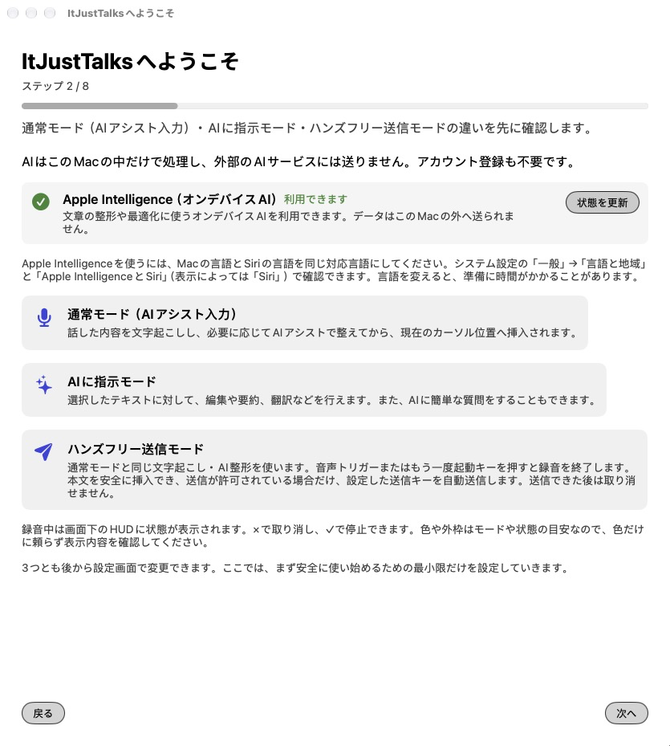
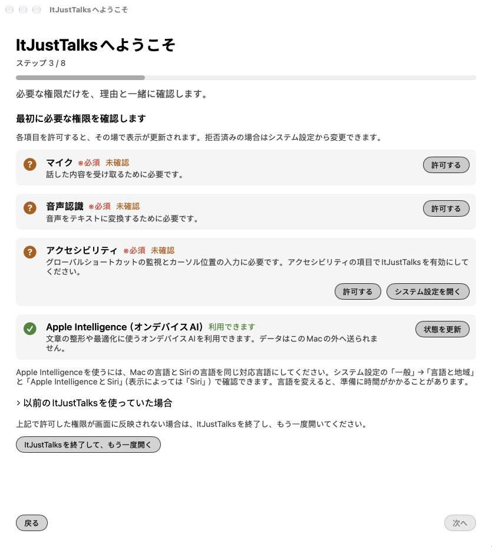
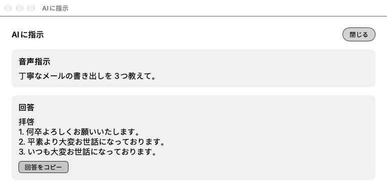
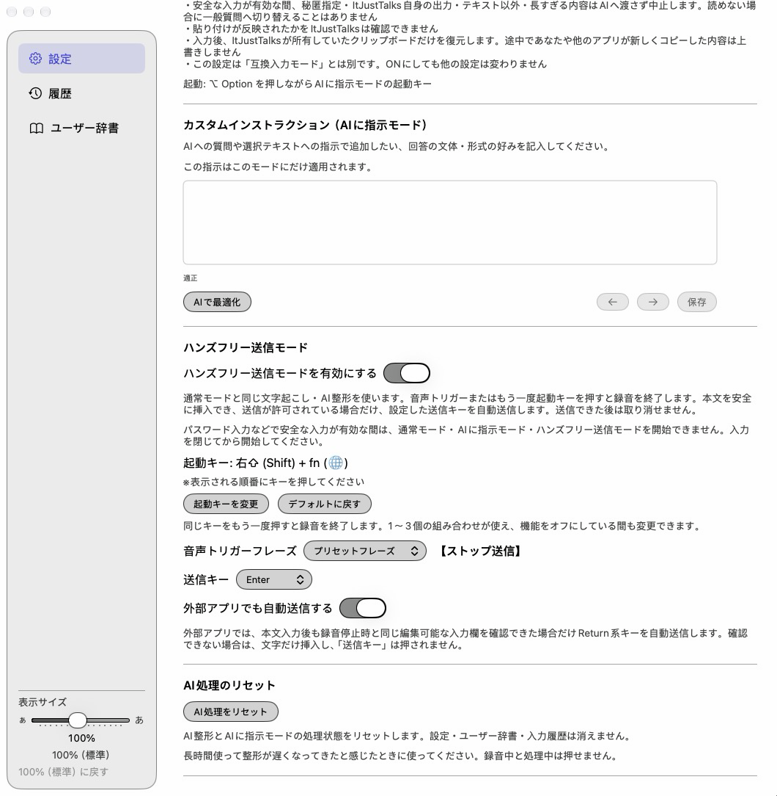
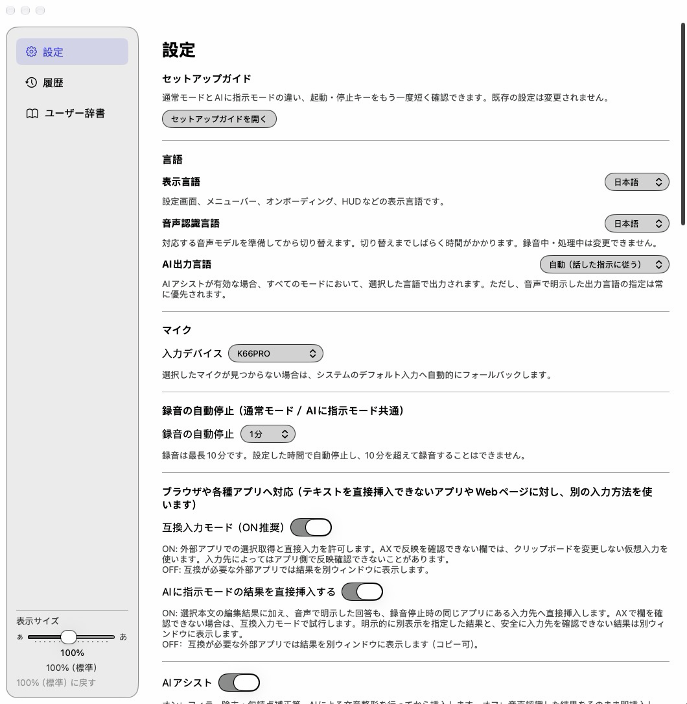
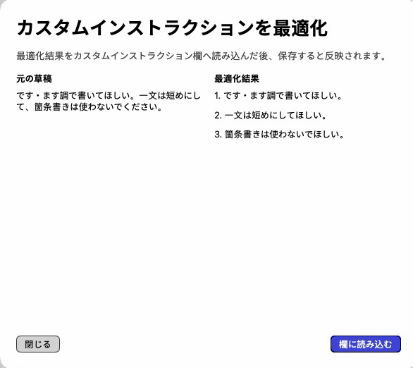
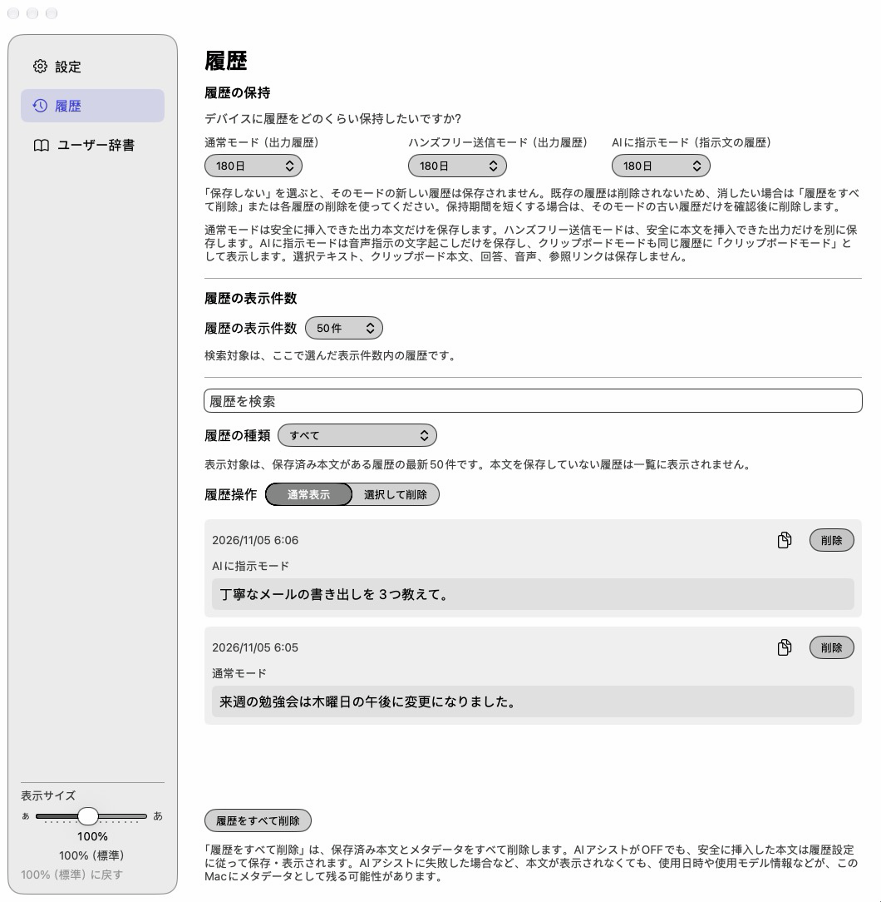
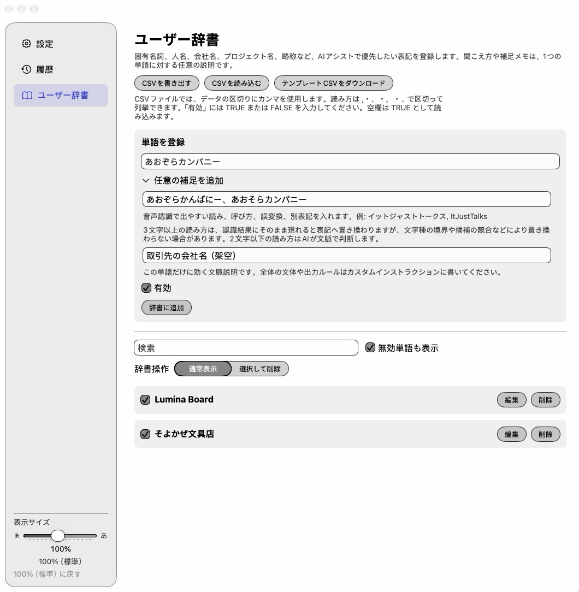
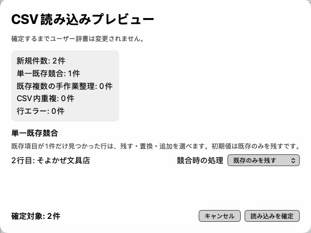
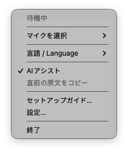

# ItJustTalks 取扱説明書（日本語）

Macの中で音声を文字にし、文章を整えたり、書き換えたりするための説明書です。

## 目次

1. [はじめに](#chapter-1)
2. [5分ではじめる](#chapter-2)
3. [動作要件と既知の制約](#chapter-3)
4. [入手とインストール](#chapter-4)
5. [初回セットアップ](#chapter-5)
6. [4つの使い方](#chapter-6)
7. [設定画面の各項目](#chapter-7)
8. [カスタム指示とAI最適化](#chapter-8)
9. [履歴](#chapter-9)
10. [ユーザー辞書](#chapter-10)
11. [メニューバー](#chapter-11)
12. [プライバシーとデータ](#chapter-12)
13. [困ったとき（トラブルシューティング）](#chapter-13)
14. [よくある質問](#chapter-14)
15. [用語集](#chapter-15)
16. [アンインストール](#chapter-16)

- [付録A：AIエージェントに導入を任せる](#appendix-a)
- [付録B：自分でソースからビルドする](#appendix-b)
- [付録C：この説明書が対象とするバージョンと配布形態](#appendix-c)
- [付録D：更新する](#appendix-d)
- [付録E：Koedex から移る方・併用する方](#appendix-e)

<a id="chapter-1"></a>
## 1. はじめに

### ItJustTalks とは

ItJustTalks は、macOS用の無料の音声入力＆文章アシスタントです。話した内容を文字にして入力したり、選んだ文章をAIに整えてもらったりできます。入力先のアプリによっては直接入力できないため、結果ウィンドウからコピーして使います。

| 使い方 | できること |
| --- | --- |
| 通常音声入力とAI整形 | 話した内容を文字にし、「えーと」などを除き、句読点を整えて入力します |
| AIに指示 | 選択した文章の校正・翻訳・要約や、質問への回答・文章作成を頼めます |
| クリップボードモード | 自分でコピーした文章を対象に、AIへ指示します |
| ハンズフリー送信 | 話した文章の入力に続けて、条件を満たす場合に送信キーを押します。初期状態ではOFFです |

ItJustTalks はKoedexから派生し、そのソフトウェアを含むApache-2.0のアプリです。

### 「AIはこのMacの中だけで処理」の意味

文字起こし、AI整形、AIに指示、クリップボードの文章処理、カスタム指示のAI最適化は端末内で行います。AIはApple Foundation Modelsのオンデバイスモデルだけを使い、入力内容をAIクラウドや独自サーバーへ送りません。Codex・ChatGPT・OpenAIのサービスは使用せず、外部AIやPrivate Cloud Computeへ切り替えることもありません。

**メールやチャットに入力した文章は、入力先アプリ自身の通信で外部へ送られます。** ハンズフリー送信も同じです。AI処理がローカルでも、送信先までMacの中にとどまるわけではありません。

Apple Intelligenceや音声認識のモデル取得、OS更新には、OS側のインターネット接続が必要になる場合があります。処理のために通信しない設計です。初回起動から接続なしで使えるとは限りません。

また、Universal Clipboard、他社のクリップボード履歴、OS診断、バックアップ、同期先への書き出しは、それぞれの設定や動作に従います。ItJustTalksだけですべての同期や通信を止めることはできません。

### 料金について

アプリの対象機能に、買い切り料金、月額料金、従量課金、機能解除の課金はありません。外部AIの契約やAPIキーも不要です。Mac本体、電力、モデル取得などに必要な環境まで無料になるという意味ではありません。

<a id="chapter-2"></a>
## 2. 5分ではじめる

アプリのインストールとモデルの準備が済んだら、まず短い文章で試しましょう。「5分」は使い始める手順の目安で、ビルドやダウンロードの完了時間を保証するものではありません。

1. [動作要件](#chapter-3)を確認し、[インストール](#chapter-4)を済ませます。
2. ItJustTalksを起動し、[初回セットアップ](#chapter-5)でマイク・音声認識・アクセシビリティを許可します。
3. マイクに声が入ることと、起動キーが反応することを確認します。
4. メモなどの文字入力欄をクリックし、`fn`（グローブ）キーを1回押します。
5. 短い文章を話して、もう一度`fn`を押します。処理が終わると文章が入力されます。
6. 入力された文章を読み、固有名詞や数字が合っているか確認します。


AIが使えない場合でも、音声認識が成功すれば通常モードでは未整形の原文（辞書の語が当てはまる時は、辞書の表記だけを反映した文）を入力できます。AIが使えるかは設定の「Apple Intelligence（オンデバイスAI）」を確認してください。

キーが反応しない時はアクセシビリティの許可、音が入らない時はマイクの許可と入力デバイスを確認します。`fn`でmacOS側の機能も動く時は、セットアップの案内からキーボード設定を確認してください。

履歴を残したくない方は、使い始める前に「履歴」タブで各モードを「保存しない」にします。初期状態では各モード180日保存です。

<a id="chapter-3"></a>
## 3. 動作要件と既知の制約

### 必要な環境と言語

| 項目 | 条件・対応範囲 |
| --- | --- |
| OS | macOS 27以降が必要です。オンデバイスAIは macOS 27 で追加された Apple Foundation Models の機能を使います。パッケージ・アプリのInfo.plist・事前確認のすべてで27以上を必須にしています |
| AI | Apple SiliconとApple Intelligenceの利用環境が必要です。実際に使えるかは、そのMacで表示されるオンデバイスモデルの状態によります |
| Macの言語とSiriの言語 | **同じ対応言語にそろえる必要があります。** 言語が違うとAIは使えません。システム設定の「一般」→「言語と地域」と「Apple IntelligenceとSiri」（表示によっては「Siri」）で確認できます |
| メモリ・チップ | 最小メモリ量やチップ世代ごとの対応一覧は確認できていません。全Apple Silicon機での動作は保証しません |
| 音声認識言語 | 日本語・英語。実行時に音声認識の対応状況も確認します |
| 表示言語 | 日本語・English。音声認識言語とは別に選べます |
| AI出力言語 | 自動・日本語・English。音声で明示した出力言語が設定より優先されます |
| その他のAI言語 | 対応言語の完全な一覧と品質は保証できません。音声認識の対応とは別です |
| 確認状況 | 0.1.0はApple M1 MacBook Air（メモリ8 GB、macOS 27.2、フルXcode 27.2）で導入済みです。0.1.1はCommand Line Toolsだけで、Apple M5 Maxでのビルドと、Apple M1 MacBook Air（macOS 27.2）での新規導入を確認済みです。OpenSSL 3がないMacでの導入は未確認です。Core 3搭載Macは未確認です。 |
| Core 3搭載機 | 未確認。動作するとは案内していません |

AIが非対応でも音声入力・文字起こしを使える場合があります。音声認識自体の対応や権限は別に必要です。

### AIの準備状態

Appleの要件として、Apple Intelligenceを使うには、Macの言語とSiriの言語を同じ対応言語にそろえる必要があります。ItJustTalksの表示言語・音声認識言語・AI出力言語は、これとは別に選べます。MacまたはSiriの言語を変えた時は、新しい言語の準備が終わるまで、AIが一時的に使えなくなることがあります。言語が違う間は、システム設定に「Apple IntelligenceとSiri」ではなく「Siri」の項目が表示され、言語についての案内が出ることがあります。

| 表示 | 確認すること |
| --- | --- |
| 利用できます | このMac内のAIを利用できます |
| Apple Intelligenceがオフです | システム設定の「Apple IntelligenceとSiri」で有効にしてください。項目が無い時は、MacとSiriの言語をそろえてください |
| このMacは対応していません | AI整形などは使えません。音声認識の利用可否は別です |
| モデルを準備中です | MacとSiriの言語が同じか確認します。同じなら、ダウンロードや準備の完了を待ち、「状態を更新」を押してください |
| 利用できません | 状態が不明、またはOSなどの条件でAIを利用できません |

### AIが使えない時・処理が失敗した時

以下のハンズフリー欄は、AIアシストをONにして録音を始めた場合です。

| 状態 | 通常音声入力 | AIに指示・クリップボード | ハンズフリー送信 | 指示のAI最適化 |
| --- | --- | --- | --- | --- |
| AI利用可能 | 整形・検査後に入力 | 生成・検査後に置換または結果表示 | 整形と送信条件を満たす時だけ入力・送信 | 候補をプレビュー |
| AI未準備・無効・非対応 | 音声認識が成功すれば原文を入力し通知 | 理由を表示し、置換しない | 原文を結果表示し、挿入・送信しない | 案内のみ。現在値を変えない |
| AI対応外の言語 | 通常は原文を入力し理由を表示 | 理由を表示し、置換しない | 原文を表示し、送信しない | 草稿を保持して失敗を案内 |
| 長すぎる | 分割を試み、分割できなければ原文をそのまま入力し案内 | 依頼に応じて分割。できなければ範囲を狭める案内 | 全区間が成功しなければ挿入・送信しない | 分割・統合。できなければ編集を案内 |
| AIの拒否・不正な結果 | 失敗は原文入力と通知。要確認なら結果表示 | 自動置換しない | 自動挿入・送信しない | 不合格の候補を適用しない |
| AIの時間切れ・取消 | AI時間切れは原文入力。取消は結果を破棄し、回収可能な原文を一時保持 | 結果破棄または失敗表示。元の選択を保持 | 送信しない | 現在値を保持 |
| 音声認識の確定が時間切れ・空 | 途中結果などを確認表示し、自動挿入しない | 指示を実行せず、元の選択を保持 | 送信しない | 対象外 |
| 音声の取得・認識が不完全 | 取得できた全文を確認表示し、自動挿入しない | 指示を実行せず、元の選択を保持 | 入力も送信もしない | 対象外 |
| 入力先・選択が変わった | 録音停止時に取り直した入力先へ入力。同じアプリ内の別の欄なら現在位置へ入ることがある | 元の選択と合わなければ自動置換を止め、結果表示へ | 入力は通常と同じ。送信は厳しい条件を満たさなければしない | 対象外 |
| 挿入できたか不確実 | 自動で再貼り付けせず確認へ | 結果表示から手動コピーへ | 自動再送しない | 対象外 |

**通常モードのAI失敗は「何も入力されない」という意味ではありません。** 未整形の原文が入力される場合があります。ただし通常モードでAIの整形に失敗し、辞書の語が当てはまった時は、辞書の表記だけを反映した文を入力し、「AIで整えられなかったため、辞書の表記だけを反映した文を入力しました。原文はメニューの「直前の原文をコピー」で取り出せます。」と通知します。続けて、AIを使えなかった理由も表示されます。当てはまる辞書の語がない時は、未整形の原文を入力し、「AI整形できなかったため、未整形の原文を入力しました。」と通知します。上の表の「原文を入力」は、辞書の語が当てはまる時は、この辞書の表記だけを反映した文の入力を指します。ハンズフリーでAIアシストを最初からOFFにした場合は、認識した原文の入力と、条件を満たした時の送信ができます。

AI処理に対応していない言語だった場合は、「この言語はAI処理に対応していません。」に続けて「AI処理の対応言語は日本語と英語です。」と表示します。

**音声の取得や認識が不完全だった時は、自動では何も入力・送信しません。** 音声認識がエラーで終わった、認識した末尾が確定しなかった、音声データの一部が失われた、のいずれかの場合です。取得できた全文を結果ウィンドウに表示し、「音声の取得または認識が不完全なため、自動処理を中止しました。取得できた全文を表示しています。内容を確認してコピーしてください。」と案内します。この案内は通常・ハンズフリー・AIに指示で共通です。AIに指示では指示を実行せず、選択した文章にも触れません。確定結果が空の場合は、上の表の「確定が時間切れ・空」と同じ扱いです。

**AIの結果に欠落や変化の疑いがあった時は、確認用の結果ウィンドウに表示します。** 次のような場合です。文や句が抜けている、「たぶん」「もし」「maybe」「only」のような推量・条件の言葉が抜けている、2つの内容のうち片方の数字が抜けている、否定が別の主語に移っている、翻訳先が中国語・韓国語・日本語なのに訳されていない。自動では置き換えず、結果ウィンドウで確認する形になります。ハンズフリーでは入力も送信もしません。「〜しておく」のような補助的な言い方や、依頼・否定など別の種類の述語が消えている場合も、確認表示になります。この判断は、途中でやめた言い出しを取り除く前の発言と比べて行います。フィラーの除去と、はっきり言い直した部分の整理は問題としません。

パスワードなどの保護された入力、権限の取消、処理の取消、古い処理結果、AIに指示での選択や入力先の不一致などでは自動適用を止めます。通常音声入力とハンズフリーは録音停止時に入力先を取り直すため、録音中に同じアプリ内の別の欄へ移ると、移った先の現在位置へ入力されることがあります（互換入力でも同様）。互換入力での外部自動送信には追加の同意が必要です。同じ編集可能欄であることを確認したうえで送る経路があり、入力文字の反映をすべてのアプリで確認できるとは限りません。

### 長文の上限と分割

| 項目 | 上限・動作 |
| --- | --- |
| 録音 | 自動停止は1・3・5・10分。初期値5分、最長10分 |
| 選択した本文・コピーした本文 | 12,000文字まで。クリップボードは前後の空白を除いて数えます。超えた分を黙って切り捨てません |
| 音声文字起こし | 一律の文字数上限は確認できていません。録音時間とAIの処理容量は別の制限です |
| AIで一度に扱う量 | 実行時のモデルと、指示・辞書・出力用の余裕などで変わります。固定の文字数やトークン数では保証しません |
| 通常の整形 | 必要なら最大8区間に分け、すべて成功した後に結合します |
| AIに指示 | 校正・書き換え・翻訳は区間を結合。要約・説明は全体を統合し、抽出は重複をまとめます。統合段階を含め16枠まで。質問回答・返信は分割しません |
| 互換入力の一部の経路 | 390 UTF-16単位まで。絵文字などでは見た目の文字数と異なります。超える場合は結果表示へ移ります。全入力経路共通の上限ではありません |

分割では段落や文などの区切りを使いますが、数字列やURLが必ずひとまとまりで扱われる保証はありません。途中の区間で失敗した場合、成功した部分だけを自動入力することはありません。通常モードでは全文の未整形原文（辞書の語が当てはまる時は辞書の表記だけを反映した文）に戻り、ハンズフリーでは確認表示になります。

長文かどうかに関係なく、依頼・否定・希望など種類の違う2つの文をAIが1つにまとめて、片方を落としてしまった場合に限り、元の発言を2つに分けて、もう1回ずつ整形し直します。結果は検査に合格した時だけ採用し、合格しなければ確認表示になります。ハンズフリーでは行いません。この時は、結果が出るまでの時間が長くなることがあります。

### 品質について知っておいてほしいこと

出力の正確さには、端末内で動くApple Foundation Modelsの性能による限界があります。送信する前や大切な用途では、内容を確認してください。

AIが元の言い回しを短くすることがあります。長文の翻訳・要約は、分けても品質が十分にならず、失敗の案内になる場合があります。長い口述では一部の内容を取りこぼすことがあります。検査ですべての誤りを見つけられるわけではないため、大切な文章や数字は確認してください。

<a id="chapter-4"></a>
## 4. 入手とインストール

このMacでソースから組み立て、自己署名して導入します。自己署名とは、このMacで作った証明書でアプリの署名を付けることです。Developer ID署名・公証（Appleによる配布用の確認）は使いません。

macOS 27以上、AI機能にはApple silicon、Apple Intelligenceの有効化、モデル準備、MacとSiriの言語の一致が必要です。Command Line Tools（コマンドで開発するためのApple製ツール。Gitを含む）だけで導入できます。フルXcodeは不要です（Xcode 27も使用可）。Homebrew・OpenSSL 3の追加導入も不要です。/Applicationsへ書き込めるアカウント（通常は管理者）と2 GBの空き容量が必要です。

ソースはZIPではなく `git clone https://github.com/GrShin5/ItJustTalks` で取得します。Desktop・Documents・iCloud Drive・File Provider配下を避け、例えば `~/Developer/ItJustTalks` に置きます。

[付録B](#appendix-b)を読み、ソースフォルダで実行します。

```sh
bash scripts/install.sh
```

証明書の作成・登録とコード署名だけの信頼設定が必要なら終了3で停止します。同意したら `bash scripts/install.sh --allow-signing-cert` を実行します。macOSの認証画面（1〜2回出ることがあります）は自分で承認してください。ツールの確認を先に行い、ビルド・署名検証・配置まで進みます。既存アプリは上書き・移動しません。更新は[付録D](#appendix-d)を使います。

導入後はFinderから起動し、[初回セットアップ](#chapter-5)を行います。導入成功は実機テスト合格ではありません。

<a id="chapter-5"></a>
## 5. 初回セットアップ

初回は次の8ステップで進みます。言語をすでに選んだ場合や、権限の復旧・任意のガイドでは、一部だけ表示されます。「次へ」で進み、「戻る」で前のステップへ戻れます。

### ステップ1：言語

「日本語」または「English」を選びます。初回の選択は表示言語と音声認識言語に使われ、AI出力は「自動」になります。あとからそれぞれ変更できます。

### ステップ2：ようこそ

「AIはこのMacの中だけで処理し、外部のAIサービスには送りません。アカウント登録も不要です。」と表示されます。「通常モード（AIアシスト入力）」「AIに指示モード」「ハンズフリー送信モード」の説明を確認します。AIに指示では選択文章の編集・要約・翻訳や簡単な質問ができます。ハンズフリーは安全に挿入でき、送信が許可された時だけ送信キーを押し、送信後は取り消せないことが説明されています。

なお、Web検索は行いません。

「Apple Intelligence（オンデバイスAI）」に現在の準備状態が表示されます。「状態を更新」で確認し直せます。利用できない場合に表示される「システム設定を開く」から、Apple Intelligenceの設定へ進めます。状態ごとの意味は[3章](#chapter-3)を参照してください。

Core 3搭載機だけに「このMacの機種（Core 3）での動作は、まだ確認できていません。不具合があればお知らせください。」という注意が表示されます。Core 3以外には表示されません。

録音中は画面下のHUDに状態が表示され、×は取消、✓は録音停止です。色だけに頼らず表示内容を確認します。3つのモードはあとから設定画面で変更できます。



### ステップ3：権限

| 権限 | 何に使うか |
| --- | --- |
| マイク | 声を録音します |
| 音声認識 | 端末内で声を文字にします |
| アクセシビリティ | 起動キーの検出、選択文章の取得、入力先の確認と文字入力に使います |

「許可する」や「システム設定を開く」と、システム設定の案内に従います。許可する対象が現在使っているItJustTalksであることを確認してください。独立した「入力監視」や「オートメーション」の許可を必須として追加する手順ではありません。

この画面にも「Apple Intelligence（オンデバイスAI）」「状態を更新」があり、利用できない場合は「システム設定を開く」が表示されます。AIの準備状態は権限とは別です。AIが使えなくても、音声認識の対応と権限があれば音声入力・文字起こしを使える場合があります。

「以前のItJustTalksを使っていた場合」を開くと、古い権限記録の対処方法と「Finderで現在のItJustTalksを表示」があります。許可が画面に反映されない場合は「ItJustTalksを終了して、もう一度開く」を使い、確認後に終了してから自分で開き直します。



### ステップ4：マイクとキー

「入力デバイス」を選び、「デバイスを確認する」を押して実際に話し、メーターが動いたら「このデバイスで設定」を押します。この確認音声は録音・保存されず、選んだマイクが見つからない場合はmacOSの既定入力を使います。

「通常モードの起動キー設定」で「キーを入力する」を押してキーを実際に押し、候補を確認して「このキーを設定する」を押します。既定は`fn`です。文字やSpaceを設定すると、そのキーは入力先へ送られず起動キーとして使われます。macOS側の操作と重なる場合は「キーボード設定を開く」で確認します。ほかの音声入力アプリが同じショートカットキーを使っていると、1回のキー操作で両方のアプリが反応することがあります。どちらかのアプリでショートカットキーを変更してください。

### ステップ5：使い方の設定

「使い方の基本設定」で「録音の自動停止」を選びます。通常モードとAIに指示モードに共通で、選択肢は「3分」「5分（おすすめ）」「10分」です。既存の設定が1分なら「1分（現在の設定）」も表示されます。安全な入力が有効な間は、3つのモードを開始できないことも説明されます。

履歴は使い始めから保存ONで、通常・ハンズフリー・AIに指示（クリップボードを含む）の各モードで初期設定180日です。「通常モードの出力履歴」で保存期間を選べます。通常は安全に入力できた出力（AIアシストがOFFなら認識した原文。AI整形に失敗した時の入力は除く）と、必要最小限の処理情報をこのMacに保存します。

以後の保存を止めるには、設定の「履歴」→「履歴の保持」でモードごとに「保存しない」を選びます。**既存の履歴は消えません。** 「履歴をすべて削除」や個別・選択削除で別途消してください。保存先も画面に表示されます。

「ハンズフリー送信モードを有効にする」は任意です。互換入力モードがONなら、チェック時に「外部アプリでも自動送信する」も同時にONになると説明されています。不要なら設定でOFFにできます。起動キー、音声トリガー、送信キーと、送信後は取り消せないことを確認します。通常モードのカスタム指示はハンズフリーのAI整形にも適用され、変更は次の録音から反映されます。有効にした場合は「ハンズフリー送信モードの出力履歴」も選べます。安全に挿入できた出力だけを保存し、送信キーだけの操作、取消、中断、失敗、確認表示に回った本文は保存しません。

### ステップ6：AIに指示

冒頭で、クリップボードはこのモードの起動キーを押した時だけ読み取ることを説明しています。初期設定は`Option`を先に押しながら`fn＋Space`です。常時監視はしません。

ハンズフリーは、音声の「ストップ送信」（音声認識言語が英語なら「Send Now」）か停止キー（初期設定`fn＋右Shift`）で止め、安全に入力できて送信が許可された時だけ送信キー（初期設定Return）を押します。自動停止やHUDの✓では入力だけで、送信しません。×は取消です。

「AIに指示モードを有効にする」でON/OFFを選び、「AIに指示モードの入力履歴」で保存期間を選びます。保存する本文は音声指示の文字起こしだけです。クリップボードモードも同じ履歴設定を使い、選択元やクリップボード本文、AIの回答、音声、参照リンクは保存しません。「保存しない」は今後の保存だけを止めます。

有効にした場合は「起動キー」「停止キー」それぞれの「キーを入力する」を押して実際のキーを入力し、「このキーを設定する」で確認します。既定の起動は`fn＋Space`、停止は`fn`です。起動は1〜3キーで、複数なら修飾キーを含め、停止は1キーです。通常モードやハンズフリー送信モードのキーと重なる起動キーは設定できず、「通常モードまたはハンズフリー送信モードですでに使われている起動キーです。別のキーを選んでください。」と表示されます（設定画面と同じ規則です）。

必要なら「クリップボードモードを有効にする」をONにします。選択文章を読み取れないアプリでは自分でコピーし、追加キーを先に押してから起動キーを押します。安全な入力、秘匿指定、ItJustTalks自身の出力、テキスト以外、長すぎる内容などはAIへ渡さず中止し、読めない時に一般質問へ切り替えません。キーが衝突する場合は設定で「追加キー」または起動キーを変更してから有効にします。

### ステップ7：練習

「文字起こしの確認（任意）」で「文字起こしを試す」を押し、話したあと「録音を停止」を押します。AI整形はせず、結果は画面にだけ表示します。設定を閉じると削除され、履歴・辞書への保存や他アプリへの入力はしません。練習は任意で、「あとで試す」で進めます。失敗してもセットアップを完了できます。

### ステップ8：完了

「セットアップが完了しました」と表示され、設定はあとから変更できることが案内されます。**メールやチャットなどの入力先アプリは、自身の機能・通信で文章を送ります。** ItJustTalksのAI処理は外部へ文章を送りませんが、ハンズフリーでは入力先アプリの送信キーを押します。

「ItJustTalksを開始」で完了すると設定画面が開きます。文字入力欄で短い文章を試してください。あとから「セットアップガイドを開く」で既存の設定を初期化せずに案内を開けます。

<a id="chapter-6"></a>
## 6. 4つの使い方

以下のキーは新規インストール時の既定値です。変更した場合は設定画面の表示に読み替えてください。

### 通常音声入力とAI整形

1. 文字を入れたい入力欄をクリックします。
2. `fn`を押し、録音が始まったら話します。
3. もう一度`fn`を押して停止します。
4. AIアシストがONなら整形・検査後、OFFなら認識した原文が入力されます。

録音方式を「長押し」にすると、キーを押している間に録音する使い方へ変更できます。AIはフィラーの除去や句読点の補正を行いますが、言い回しの保持を完全には保証しません。

フィラーの除去は、話した本人が実際に言いよどんだ時だけ行います。対象は「えっと」「えーと」「えー」「あのー」と、英語の「um」「uh」です。この自動の除去では、「ええ」「ううん」「うーん」は返事や内容として残します。「まあ」「なんか」は、話した原文でも前後が区切られて単独で出てきた時だけ取り除きます。かぎ括弧や引用符の中の言葉には手を加えません。ただし、AIの整形そのもので、これらの語が消えることがあります。

要確認の結果や入力先が変わった場合は、結果ウィンドウで確認します。AIが失敗した時は、通常モードでは原文が入力される場合があります。直前の通常入力の原文はメモリに一時保持され、メニューの「直前の原文をコピー」で回収できます。次の録音を始めるか、10分たつと消えます。長期保存の履歴とは別です。

### AIに指示

1. 書き換えたい文章を選択します。質問や新しい文章の作成なら、選択せずに始めます。
2. `fn＋Space`を押します。
3. 「この文章を英語にして」「短く要約して」などと話します。
4. `fn`を押して停止します。
5. 正常な編集結果は自動置換の候補になります。回答は原則として結果ウィンドウに表示されます。



「ここに入力して」など音声で挿入を指定した場合も、録音開始時と実際の入力時の両方で直接挿入への同意が必要です。選択本文・辞書・保存したカスタム指示に出力先を書いても、出力先は変わりません。

選んだ文章への返信を頼みたい時は、「この文章に返信して」「丁寧に返信して」のように、返信の依頼で終わる言い方で話します。返信案は原則として結果ウィンドウに表示され、選択した文章は書き換えません。返信は分割して処理しません。「丁寧に返信して」と丁寧さを添えても、書き換えではなく返信として扱います。ただし、「下書きを直して返信して」のように文章を直す言葉が入っている場合は、返信としての扱いにはならず、AIの判断に従います。

互換入力、クリップボードを使った貼り付け、AIの結果による自動置換の同意は、いずれも「録音を始めた時の設定」と「入力する時の設定」の両方がONの時だけ有効です。処理の途中で設定をONにしても、その処理には反映されません。OFFにした場合は、その処理にも反映されて入力を止めます。

元の選択が変わった時や編集できる入力欄か確認できない時は、自動置換を止めます。結果ウィンドウからコピーして使ってください。送信、ファイル保存、他アプリ操作は依頼できません。最新情報を調べたい場合は、その本文を自分で用意してください。

アプリによっては、選択文章を取り込むために一時的にコピー操作を使います。その途中でクリップボードが想定外に変わった（2回以上変化した）場合は、取り込みを中止します。この場合、あなたが新しくコピーした内容を、元の内容で上書きして戻すことはしません。

### クリップボードモード

初期状態ではOFFです。設定で「クリップボードモードを有効にする」をONにして使います。

1. 処理したい文章を自分でコピーします。
2. 追加キーの`Option`を先に押したまま、`fn＋Space`を押します。
3. コピーした文章への指示を話し、`fn`で停止します。
4. 生成結果を確認します。直接挿入の設定や入力先の確認結果に応じて、挿入または結果表示になります。

追加キーは左右どちらでも使え、Command・Controlにも変更できます。コピーした本文は12,000文字までです。非テキスト、安全に扱えない内容、秘匿指定のある内容、アプリ自身の出力などは読み取りを拒否する場合があります。読み取れなかった時に、本文のない一般質問へ勝手に切り替えません。

クリップボードモードは「どの本文をAIへ渡すか」の設定です。「互換入力モード」は「結果をどう入力するか」の設定で、別のものです。

### ハンズフリー送信

初期状態ではOFFです。有効にする前に、入力先アプリでどのキーが送信になるか確かめてください。既定の送信キーはReturnで、Command＋Return・Control＋Returnにも変更できます。

1. 設定でハンズフリー送信を有効にし、送信キーを確認します。
2. 送信したい入力欄をクリックし、`fn＋右Shift`を押します。
3. 本文を話します。
4. 日本語の音声認識なら「ストップ送信」、英語なら「Send Now」と言うか、もう一度`fn＋右Shift`を押します。
5. 合図を除いた本文を認識・整形し、安全条件を満たす時だけ入力と送信キーの操作を行います。



**録音時間による自動停止や、HUDの✓による停止では送信しません。** それらは入力だけの扱いです。ただし、要確認の結果やAI失敗などでは入力も止めます。音声の合図だけを話した場合は、本文を追加せず送信キーだけを押す場合があります。

送信時には同じ入力欄か、権限や同意が有効かなどを確認します。AIアシストONで整形に失敗した時は、原文へ切り替えて自動送信せず、確認表示にします。AIアシストを最初からOFFにした時は原文を使います。

互換入力を使う外部アプリへの自動送信には「外部アプリでも自動送信する」の追加確認が必要です。録音開始時と送信時の両方で同意が必要で、すべてのアプリで本文の反映まで確認できる保証はありません。

ハンズフリーでは、入力結果を確認できない互換入力の経路に、改行を含む文章は入力しません（改行には、CRLFや段落区切りなどの特殊な改行も含みます）。この場合は結果ウィンドウに表示するので、手動でコピーして使います。自動停止やHUDの✓で終えた場合も同じです。

送信キーの意味は入力先アプリに従います。メールやチャットが実際に文章を送る時は、そのアプリ自身が通信します。

### 途中でやめたい・入力できたか分からない時

HUDの×で録音や処理を取り消せます。取り消した処理のAI結果が遅れて届いても入力しません。入力できたか不明な場合は自動で再貼り付け・再送信せず、結果表示へ移ります。コピーする前に、入力先に同じ文章が入っていないか確認してください。

<a id="chapter-7"></a>
## 7. 設定画面の各項目

タブは「設定」「履歴」「ユーザー辞書」です。以下の既定値は新規インストール時の値で、以前から使っている場合の値とは異なることがあります。「—」は保存値のないボタンなどの操作です。ONは有効、OFFは無効を表します。



### 共通の表示

| 表示名 | 既定値 | 意味 |
| --- | --- | --- |
| 表示サイズ | 100% | 65〜140%、5%刻み。設定・履歴・辞書に共通 |
| 100%（標準）に戻す | — | 表示倍率を標準に戻す |

### 「設定」タブ：基本

| 表示名 | 既定値 | 意味 |
| --- | --- | --- |
| セットアップガイドを開く | — | 既存の設定を変えず任意ガイドを開く |
| 表示言語 | 日本語 | 日本語/English。画面・メニュー・HUDの言語 |
| 音声認識言語 | 日本語 | 日本語/English。モデル準備後に変更。録音/処理中は変更不可 |
| AI出力言語 | 自動（話した指示に従う） | 自動/日本語/English。発話の明示指定優先 |
| 入力デバイス | 自動（システム既定） | 選択したマイクがなければシステム既定へ |
| 録音の自動停止 | 5分 | 1/3/5/10分、最長10分 |
| 互換入力モード（ON推奨） | ON | 通常のアクセシビリティ経路で扱えない外部アプリへの互換入力を許可 |
| AIに指示モードの結果を直接挿入する | ON | 選択編集/明示挿入の外部アプリ経路。互換入力OFFでは操作不可 |
| AIアシスト | ON | フィラー除去・句読点等の整形。OFFでは認識結果を直接入力 |
| Apple Intelligence（オンデバイスAI） | 実行時状態 | AIの利用可否を表示。状態の意味は3章参照 |
| 状態を更新 | — | Apple Intelligence状態を再取得 |
| AI処理をリセット | — | AI処理の内部状態を作り直す。設定・辞書・履歴は削除しない。録音・処理中は操作不可 |

### 「設定」タブ：通常音声入力

| 表示名 | 既定値 | 意味 |
| --- | --- | --- |
| 起動キーを変更 | fn | 通常モード用の単一キーを実入力で変更 |
| 録音方式 | ワンタップ | ワンタップまたは長押し |
| キーボード設定を開く | — | fn利用時のmacOSキーボード設定を開く |
| カスタムインストラクション（通常モード / ハンズフリー送信モード） | 空 | 文体・形式の希望。長さ表示付き |

### 「設定」タブ：AIに指示・クリップボード

| 表示名 | 既定値 | 意味 |
| --- | --- | --- |
| AIに指示モード | ON | 無効時はAI指示ホットキーを監視せずキー設定も操作不可 |
| 起動キーを変更 | fn＋Space | 1〜3個の組合せ、複数キーは修飾キーが必要 |
| 停止キーを変更 | fn | 単一キー |
| クリップボードモードを有効にする | OFF | 選択の代わりにコピー済み本文を使う。互換入力とは独立 |
| 追加キー | Option | Option/Command/Control。キー衝突・成立可否を検査 |
| デフォルトに戻す | — | AI指示キーの既定復元 |
| カスタムインストラクション（AIに指示モード） | 空 | AI指示だけに使う文体・形式の希望、長さ表示付き |

### 「設定」タブ：カスタム指示の共通操作

| 表示名 | 既定値 | 意味 |
| --- | --- | --- |
| AIで最適化 | — | 編集中の指示から候補を生成。直ちに保存しない |
| 保存 | — | 編集中の指示を使用する設定へ保存 |
| 取消 | — | 実行中の最適化を中止 |
| 保存済み履歴を1つ戻る | — | 保存した指示履歴を前へ |
| 保存済み履歴を1つ進む | — | 保存した指示履歴を次へ |
| 欄に読み込む | — | プレビュー候補を編集欄に読み込む。反映には保存 |
| 閉じる | — | 候補プレビューを閉じる |

### 「設定」タブ：ハンズフリー送信

| 表示名 | 既定値 | 意味 |
| --- | --- | --- |
| ハンズフリー送信モードを有効にする | OFF | 同一起動キーまたは音声トリガーで停止して条件付き送信 |
| 起動キーを変更 | fn＋右Shift | 1〜3キー。OFF中も変更可能 |
| デフォルトに戻す | — | ハンズフリーキーを既定へ |
| 音声トリガーフレーズ | プリセットフレーズ | プリセット/カスタムを選択。日本語はストップ送信、英語はSend Now |
| カスタムフレーズ | 空 | 見た目の文字のまとまりで4〜20文字、1行。引用符やプリセットと同じ句は不可。編集・保存が可能 |
| 送信キー | Enter | Enter / ⌘ Enter / ⌃ Enter |
| 外部アプリでも自動送信する | OFF | 追加確認を伴う同意。互換入力とハンズフリーが有効時のみ操作可 |

### 「履歴」タブ

| 表示名 | 既定値 | 意味 |
| --- | --- | --- |
| 通常モード（出力履歴） | 180日・保存ON | 保存しない/1日/30日/180日/無期限。保存内容は[9章](#chapter-9)参照 |
| ハンズフリー送信モード（出力履歴） | 180日・保存ON | 保存しない/1日/30日/180日/無期限。保存内容は[9章](#chapter-9)参照 |
| AIに指示モード（指示文の履歴） | 180日・保存ON | 保存しない/1日/30日/180日/無期限。保存内容は[9章](#chapter-9)参照 |
| 履歴の表示件数 | 50件 | 50/100/200/すべて。検索は表示対象内 |
| 履歴を検索 | 空 | 本文検索 |
| 履歴の種類 | すべて | 通常/ハンズフリー/AI指示/すべて |
| 履歴操作 | 通常表示 | 通常表示/選択して削除 |
| 履歴を再読み込み | — | 不正・読込不可状態から読み直す |
| すべて選択 | — | 表示対象を全選択。選択済み時は選択を解除 |
| チェックしたものをすべて削除 | — | 選択履歴を確認後に削除 |
| チェックしたもの以外をすべて削除 | — | 表示対象のうち未選択分を確認後に削除 |
| 表示されていないメタデータをすべて削除 | — | 本文のない処理情報を削除 |
| 履歴をすべて削除 | — | 本文とメタデータを全削除 |
| 削除 | — | 各履歴の削除 |
| コピー / コピー済み | — | 通常は画像。ポインタを重ねた時またはコピー済み時に文字表示 |

### 「ユーザー辞書」タブ

| 表示名 | 既定値 | 意味 |
| --- | --- | --- |
| 単語・表記（例: ItJustTalks） | 空 | 優先する表記。必須 |
| 任意の補足を追加 | 閉 | 読み・メモ欄を展開 |
| 読み方・聞こえ方 等（,・、・，・､ 区切りで列挙） | 空 | 読み/誤認識/別表記 |
| 補足メモ（任意） | 空 | その語に関する説明 |
| 有効 | ON | 登録語をAIに渡す候補に含める。登録済みの語もON/OFFを変更可能 |
| 検索 | 空 | 登録語を絞り込む |
| 無効単語も表示 | ON | 無効にした語も表示 |
| 辞書操作 | 通常表示 | 通常表示/選択して削除 |
| CSVを書き出す | — | 登録辞書をCSVへ保存 |
| CSVを読み込む | — | CSVを検査し、取込内容を確認する画面へ |
| テンプレートCSVをダウンロード | — | 入力用CSVを保存 |
| 新規登録に戻る | — | 編集を終え新規フォームへ |
| 辞書に追加 | — | 入力内容を登録 |
| 変更を保存 | — | 編集内容を保存 |
| キャンセル | — | 編集中の変更を取り消す |
| すべて選択 | — | 表示項目をすべて選択、または選択を解除 |
| チェックしたものをすべて削除 | — | 選択辞書を確認後削除 |
| チェックしたもの以外をすべて削除 | — | 表示中の未選択辞書を確認後削除 |
| 編集 | — | 既存語をフォームへ |
| 削除 | — | 既存語を確認後削除 |
| 安全用バックアップの保存を再試行 | — | 安全用バックアップの書込みを再試行 |

### 辞書のCSV取込画面

| 表示名 | 既定値 | 意味 |
| --- | --- | --- |
| 読み込みを確定 | — | 検査済み追加/競合解決を確定 |
| キャンセル | — | 取込みプレビューを閉じる |
| 既存のみを残す | 既存のみを残す | 既存の1項目と重なる場合の初期選択。置換/別項目追加へ変更可能 |
| 競合時の処理（既存のみを残す / 置換する / 同じ語を追加する） | 既存のみを残す | 同じ語が既存項目と重なる行の取込方針 |

### 辞書の復旧画面

| 表示名 | 既定値 | 意味 |
| --- | --- | --- |
| 辞書の復旧を再開 | — | 折り畳んだ復旧表示を再開 |
| 確認できた項目を救出（推奨） | — | 破損元を保全して確認済み項目を救出 |
| 空の辞書で再開 | — | 確認・バックアップ後に空辞書へ |
| 再試行 | — | 保存内容を再解析 |
| 保存場所をFinderで開く | — | 辞書の保存フォルダを表示 |
| 後で | — | 復旧表示を折り畳む |

復旧画面では、利用できるバックアップがあると、その候補名のボタンも表示されます。「コピー」は通常アイコンで、ポインタを重ねた時やコピー済みの時に文字が表示されます。保存した指示の前後移動は矢印ボタンで行います。

「AI処理をリセット」は設定・辞書・履歴を削除する操作ではありません。処理が戻らない時に使いますが、録音や処理の最中は操作できません。

「保存しない」は既存の履歴の削除ではありません。過去の内容も消したい時は削除操作を行ってください。保存期間を短くすると、確認後にそのモードの期限を過ぎた履歴だけを削除します。

辞書のCSV取込の上限は、ファイル8 MiB、データ1,000行、ヘッダー64列、表記100文字、読み1個100文字・最大20個、メモ500文字です。これは手動登録を含む辞書全体の上限ではありません。辞書全体の総登録件数上限は確認できていません。

<a id="chapter-8"></a>
## 8. カスタム指示とAI最適化

### 2種類のカスタム指示

| 種類 | 使われる場面 | 初期値 |
| --- | --- | --- |
| カスタムインストラクション（通常モード / ハンズフリー送信モード） | 通常のAI整形とハンズフリーのAI整形に共通 | 空 |
| カスタムインストラクション（AIに指示モード） | AIに指示と、その入力元をコピー済み本文にしたクリップボードモード | 空 |

「です・ます調にする」「箇条書きを使う」など、文体や形式の希望を書きます。出力先や送信・保存・他アプリ操作の許可を変えるものではありません。AIが希望を必ずすべて守る保証もありません。

### 長さの目安と上限

**AIが作る最適化候補は最大5項目、改行を含めて500文字まで**です。ここでいう文字数は見た目の文字のまとまりで数えます。手入力の指示欄すべてに500文字の上限がある、という意味ではありません。

手入力の指示が使えるかは、AIの処理容量と本文などの長さによって変わります。長さ表示ではモデルの容量の10%以上で「長め」、25%以上で「処理できない長さ」の警告になります。表示自体が保存を拒否したり、末尾を切ったりするものではありませんが、長すぎる指示は実際の処理時に使えないことがあります。必要な希望を短くまとめてください。

### AIで最適化する手順

1. 使いたい種類の指示欄に、希望を書きます。
2. 「AIで最適化」を押します。AIの利用可否と処理できる量を確認し、必要なら草稿を分けて処理・統合します。
3. 元の草稿と候補を並べたプレビューで、大切な希望が残っているか読み比べます。
4. 採用する場合は「欄に読み込む」を押します。候補が編集欄へ入ります。
5. 必要なら手で直し、**「保存」を押します。ここで初めて使用する設定として保存されます。**



候補を生成しただけでは設定は保存されません。「閉じる」で採用せずに戻れます。保存に失敗した時は「カスタムインストラクションを保存できませんでした。草稿は残っています。もう一度「保存」を押してください。」と表示され、草稿は消えずに残るので、もう一度保存できます。長さを超えた候補の作り直しは最大1回で、元の草稿を黙って切り捨てることはありません。ただし、候補にすべての希望が含まれる保証はないため、採用前に確認してください。

最適化中は「取消」で中止できます。録音を始めた場合も最適化を中断し、草稿と設定を保持して再実行を案内します。AIが利用できない、処理できない長さ、候補の検査に通らないといった場合は、現在の設定を候補で上書きしません。

最適化では、元の草稿に出てくる辞書項目だけを候補にし、辞書の補足メモは渡しません。Web・送信・保存などの動作に触れる項目には「この項目はアプリの動作を変えません」という注記が付きます。

保存済みの指示履歴は2種類それぞれ最大20件です。前後の矢印で保存した内容を参照できます。

<a id="chapter-9"></a>
## 9. 履歴

設定画面の「履歴」タブで、過去の出力や音声指示を確認・コピーできます。録音した音声を再生する履歴ではありません。



### 保存される内容

| モード | 初期の保存期間 | 保存される本文 |
| --- | --- | --- |
| 通常モード | 保存ON・180日 | 安全に入力できた出力。AIアシストがOFFの時は認識した原文を保存します。AI整形に失敗して原文や辞書だけを反映した文を入力した時は、本文を保存しません |
| ハンズフリー送信モード | 保存ON・180日 | 安全に入力できた出力。送信キーだけの操作、取消、確認表示に回った結果の本文は保存しません |
| AIに指示・クリップボードモード | 共通で保存ON・180日 | 話した指示の文字起こしだけ。選択元やコピーした本文、AIの回答、音声、参照リンクは保存しません |

本文が保存されない処理にも、モードや処理に関する情報だけが残る場合があります。画面の「表示されていないメタデータ」は、このような本文のない情報を指します。

### 保存を止める・期間を変える

「履歴」タブで、通常・ハンズフリー・AIに指示それぞれの保存期間を選びます。

- 「保存しない」：そのモードの以後の履歴保存をOFFにします。既存の履歴は消えません。
- 「1日」「30日」「180日」「無期限」：保存する期間を選びます。

期間を短くする時は確認が表示され、確認後にそのモードの期限を過ぎた履歴を削除します。すべてのモードの保存を止めたい場合は、3つとも「保存しない」にしてください。

AIに指示の履歴は、録音の開始時と保存する時の両方で保存がONの場合だけ残ります。録音の途中で「保存しない」にすると、その録音の指示文は保存されません。

### 探す・コピーする・削除する

履歴の種類を選び、必要なら「履歴を検索」に文字を入れます。初期の表示件数は50件です。検索は表示対象の範囲内なので、古い内容を探す時は表示件数を増やしてください。各項目のコピーボタンで本文をコピーできます。

削除方法は次のとおりです。

| 操作 | 削除するもの |
| --- | --- |
| 各項目の「削除」 | その項目 |
| 「履歴操作」→「選択して削除」→「チェックしたものをすべて削除」 | 選んだ項目 |
| 「チェックしたもの以外をすべて削除」 | 表示対象のうち選んでいない項目 |
| 「表示されていないメタデータをすべて削除」 | 本文のない処理情報 |
| 「履歴をすべて削除」 | 本文と処理情報を含むすべての履歴 |

削除の確認が出たら対象を読んでから進めます。読み取りに問題がある時は、内容を壊す書き換えを止めます。「履歴を再読み込み」が表示された場合は、再読み込みを試してください。

履歴ファイルが壊れていて読み取れない時は、個別の削除や期間による整理はできません。この場合でも「履歴をすべて削除」は使えます。「破損または読み取れない履歴ファイル全体を削除します。表示できない本文やメタデータもすべて削除されます。件数は確認できません。この操作は元に戻せません。」という確認が出るので、読んでから進めてください。削除すると、途中に残っていた一時ファイルも一緒に取り除きます。

### 保存先

アプリのデータは`~/Library/Application Support/ItJustTalks/`に保存されます。履歴ファイルは、この中の`history/input_history.jsonl`です。Finderの「移動」→「フォルダへ移動…」に保存先を入力すると開けます。通常の削除や期間変更には、ファイルを直接編集せず履歴タブを使ってください。

保存先のフォルダ内では、シンボリックリンク（別の場所を指す参照）やハードリンク（同じ実体への別名）を辿りません。履歴・設定・動作ログ・辞書の復旧用ファイル・カスタム指示の状態・セットアップの再起動情報がリンクになっていると、読み書きを拒否します。「履歴をすべて削除」もリンクは辿りません。

<a id="chapter-10"></a>
## 10. ユーザー辞書

人名、固有名詞、製品名など、使いたい表記を登録する機能です。AIに渡す表記の手掛かりになるもので、すべての認識や出力が必ず希望どおりになる保証はありません。

### 単語を登録する

1. 設定画面の「ユーザー辞書」タブを開きます。
2. 「単語・表記」に、出力したい書き方を入れます。
3. 必要なら「任意の補足を追加」を開き、「読み方・聞こえ方 等」と「補足メモ」を入れます。
4. 「有効」がONであることを確認し、「辞書に追加」を押します。



読みは、カンマや読点（`,`・`、`・`，`・`､`）で区切って複数登録できます。例えば表記を「ItJustTalks」、読みを「イットジャストトークス」とします。メモはその語に関する短い説明に使います。

登録済みの語は「編集」で開き、「変更を保存」で更新します。一時的に使わない語は無効にできます。検索や「無効単語も表示」で項目を探せます。保存に失敗した時は「辞書の変更を保存できませんでした。入力内容は残っています。もう一度試してください。」と表示され、入力内容は消えずに残ります。

### CSVからまとめて読み込む

1. 「テンプレートCSVをダウンロード」で入力用ファイルを保存します。
2. テンプレートに沿って表記・読み・メモなどを記入します。
3. 「CSVを読み込む」でファイルを選び、検査結果と取込プレビューを確認します。
4. 既存の語と重なる項目は、「既存のみを残す」「置換する」「同じ語を追加する」から選びます。既定は「既存のみを残す」です。
5. 「読み込みを確定」で反映します。「キャンセル」なら取り込みません。反映を保存できなかった時は「CSVの読み込みを保存できませんでした。内容と選択は残っています。もう一度試してください。」と表示され、取込画面の内容と選択は残ります。



| CSV読込時の制限 | 上限 |
| --- | --- |
| ファイルサイズ | 8 MiB |
| データ行 | 1,000行 |
| ヘッダー列 | 64列 |
| 表記 | 100文字 |
| 読み | 1個100文字、最大20個 |
| メモ | 500文字 |

**この表はCSV読込だけの制限です。手動登録を含む辞書全体の制限ではありません。** 辞書全体の総登録件数上限は確認できていません。手動登録では空の表記を登録できず、前後の空白や読みの重複などを整理します。

「CSVを書き出す」で登録内容を保存できます。CSVには登録語やメモが含まれるため、保存先や共有先を確認してください。

### AIにはどう渡るか

毎回すべての辞書を渡すのではなく、有効な項目のうち、対象本文の表記や読みに合う語を選びます。既定では最大8項目、AIが扱う量の概算で200トークンまで、読みは1項目につき最大5個を使います。登録数と、一度の処理に使う数は別です。

通常のAI生成では選ばれた語の補足メモも使います。カスタム指示のAI最適化では元の草稿に言及のある語だけを選び、メモは使いません。いずれもMac内のAI処理です。

3文字以上の読みが文字どおり一致した場合は、決まった処理で登録表記に置き換える対象になります。ただし、文字種の境界や候補の競合などで置き換わらないこともあります。2文字以下の読みはAIの文脈判断によります。音だけで選んだ語の使用や、元の発話の根拠を超える置換が検査で見つかると、ハンズフリーでは確認表示にして自動送信を止めます。

音声認識が登録語を、同じ音の別の漢字やひらがなに取り違えた時は、登録語の読みの音と見比べて、登録した表記に置き換えることがあります。対象は、本文に合うと選ばれた登録語だけです。読みが5拍以上の語、または、認識された部分が複数の語に分かれている場合は4拍以上の語に限ります。1語として認識された4拍以下の部分や、数字を含む部分は対象外です。

### 音声認識と連続する語の扱い

通常の録音を始める時、有効な辞書の表記を音声認識の手掛かりとして渡します。新しく登録した語から最大100件までです。ハンズフリー送信の録音では、似た音の語を自動送信してしまわないよう、この手掛かりは使いません。処理はこのMacの中だけで行います。

辞書の語を続けて話し、「コーデックスクロードコード」のように1つのカタカナの連なりとして認識された時は、辞書の読みに分けて、それぞれの表記をつないで入力します。つなぎ方は、前後の近くにある文字で決まります。近くに日本語（かな・漢字）がなく英字がある英語の文脈では「, 」（カンマと空白。例：「Codex, Claude Code」）、それ以外の日本語の文脈では「、」（例：「Codex、Claude Code」）です。連なり全体が、長音「ー」を数えずに3文字以上の読みだけでちょうど埋まる場合に限ります。埋まらない時は何も置き換えません。「ジェmini」のようにカタカナと英字が混ざった断片も、登録語の読みの頭のカタカナと表記の終わりの英字が明確に合う時は変換します。

2文字の読みや「コード」「メール」のような短い語は、この方法では分けません。「クロードコード」→「Claude Code」のように、より長い語句を読みとして登録してください。

### 言い直しの整理

同じ言い出しを何度も言い直した時は、やめた言い出しをAIの整形の前に取り除きます。間に「えー」「えっと」「あの」などが入っていても同様です。取り除くのは、読点・カンマ・「…」などで区切られた、同じ1つの文の中の言いかけだけです。文末（。．.！？!?や改行）をまたいで文を削ることはありません。完全な文のあとに、同じ書き出しの別の文が続く場合は両方残します（例：「契約書に署名しました。契約書に署名してください」、「資料を送った。資料を送ってください」）。

句読点がなくても、完結した文のあとに依頼・希望が続く場合や、否定の有無が違う場合は、言い直しとは見なさず削りません（例：「棚を整理しました棚を整理してください」は両方残します）。

「もう一度」「一度確認して」のように言い回しとして使う「一度」は、数量とは見なしません。「室温は一度です」のように温度などを表す場合は数字として守り、言い直しの整理で削りません。

### 辞書を読み込めない時

復旧画面が出たら、まず内容を確認します。「確認できた項目を救出（推奨）」は破損元を保全して救出を試みます。「空の辞書で再開」は確認とバックアップを経て空の辞書へ戻す操作です。すぐに決めない場合は「後で」で閉じ、あとから「辞書の復旧を再開」で戻れます。

<a id="chapter-11"></a>
## 11. メニューバー

画面上部のメニューバーにあるItJustTalksのアイコンをクリックすると、状態や主な操作が表示されます。設定画面を開いたままにしておく必要はありません。



| 項目 | 使い方 |
| --- | --- |
| 現在の状態・通知 | 録音や処理の状態、設定保存・ストレージなどの問題を確認します |
| ストレージの問題を確認 | 問題がある時に表示され、辞書や履歴の確認画面を開きます |
| マイクを選択 | システム既定のマイク、または接続中のマイクを選びます |
| 言語 / Language | 日本語・英語の言語設定をまとめて切り替えます。表示と音声認識を選んだ言語、AI出力を自動にします |
| AIアシスト | 通常・ハンズフリーのAI整形をON/OFFにします |
| 最後のAI出力をコピー | 利用できる最後のAI指示の出力がある時に表示されます |
| 直前の原文をコピー | 通常入力の回収可能な原文をコピーします。メモリでの保持は、次の録音を始めるまで、または10分までです |
| セットアップを再開… | 再開が必要な時に表示されます |
| セットアップガイド… | 使い方の案内を開きます |
| 設定… | 設定・履歴・ユーザー辞書の画面を開きます |
| 終了 | アプリを終了します |

表示言語と音声認識言語を別々に選びたい場合は、メニューの一括切替ではなく、[7章の設定画面](#chapter-7)を使ってください。「AI処理をリセット」は設定画面にあります。

<a id="chapter-12"></a>
## 12. プライバシーとデータ

### Macの中で行う処理

文字起こし、文章整形、AIに指示、コピーした文章の処理、カスタム指示の最適化は端末内で行います。AIはApple Foundation Modelsのオンデバイスモデルだけを使います。外部AIへの切替、Web検索、アプリを利用するためのアカウント登録や外部AI認証はありません。

入力内容をItJustTalksからAIクラウドや独自サーバーへ送ることはありません。ただし、モデル取得やOS更新など、OS自身の通信は別です。

### ローカル処理と、入力先の通信は別

**メールやチャットへ入力・送信した文章は、そのアプリ自身の通信で外部に送られます。** ハンズフリーが送信キーを押した場合も同じです。入力先アプリの送信先や保存・同期の設定は、ご自身で確認してください。

Universal Clipboard、他社のクリップボード履歴、バックアップ、同期先フォルダへのCSV書き出しなども、ItJustTalksだけでは制御できません。ローカル処理は、他のアプリやOSが持つ通信機能を止めるものではありません。

### 保存されるデータ

保存先は`~/Library/Application Support/ItJustTalks/`です。Koedexとは別の保存先です。初回セットアップ用のDebug版は`~/Library/Application Support/ItJustTalks Debug/`を使い、通常版とも分かれています。

| データ | 保存先フォルダ内のファイル |
| --- | --- |
| 設定 | `settings.json`。形式の移行前バックアップが残る場合があります |
| ユーザー辞書 | `personal_dictionary.json`。安全用・取込前のバックアップや`Recovery/`もあります |
| 入力履歴 | `history/input_history.jsonl` |
| 通常・ハンズフリー用のカスタム指示状態 | `custom_instruction_state.json`。旧形式の読込候補は`personalization_state.json` |
| AIに指示用のカスタム指示状態 | `ai_command_custom_instruction_state.json` |
| 動作ログ | `logs/itjusttalks.log`と世代ファイル |
| セットアップの再起動情報 | `onboarding_restart_intent.json` |
| 署名証明書の控え | `itjusttalks_dev_cert.crt`。証明書の作成で信頼設定を完了できなかった時だけ作られ、手動で完了するために使います |

履歴には本文が保存される場合があります。保存する内容とOFFにする方法は[9章](#chapter-9)を確認してください。ログと履歴は別です。

### ログの本文保護の設計と検査

動作ログは件数・処理時間・失敗理由などを記録します。文字起こし、選択文章、クリップボード、辞書、カスタム指示の本文をログに出さない設計で、検査スクリプトでも確認しています。エラーも種類やコードに絞って記録します。ログが5 MiBを超えると、過去2世代のファイルへ入れ替えます。

ログを送る時にも内容を確認してください。画面のスクリーンショット、履歴ファイル、辞書CSV、設定ファイルには、ログとは別にご自身の情報が含まれる場合があります。

<a id="chapter-13"></a>
## 13. 困ったとき（トラブルシューティング）

### AIが使えない

設定画面の「Apple Intelligence（オンデバイスAI）」で確認します。

| 状態・症状 | 対処 |
| --- | --- |
| Apple Intelligenceがオフです | システム設定の「Apple IntelligenceとSiri」でONにします。項目が無い時は、MacとSiriの言語をそろえます |
| モデルを準備中です | MacとSiriの言語が同じか確認します。同じなら、OS側のダウンロード・準備を待ち、「状態を更新」で確認します |
| このMacは対応していません | AI機能は利用できません。音声認識の対応と権限があれば、通常の文字起こしを使えます |
| 利用できません | macOS 27であることを確認します。状態が不明な場合は、時間を置いて更新してください |
| 利用できますが処理に失敗します | 文章や指示を短くして試します。時間切れが続く時は、録音・処理が終わってから設定の「AI処理をリセット」を試します |
| 対応外の言語と案内されます | 「この言語はAI処理に対応していません。」に続けて「AI処理の対応言語は日本語と英語です。」と表示されます。音声認識言語とAI出力言語を確認します。音声認識で使える言語が、AIでも必ず使えるとは限りません |

通常モードはAI失敗・時間切れ時に原文（辞書の語が当てはまる時は辞書の表記だけを反映した文）を入力する場合があります。AIに指示は置換せず、AI整形ONのハンズフリーは送信を止めます。詳しい違いは[3章](#chapter-3)の表を確認してください。

### 録音できない・キーが反応しない

| 確認すること | 対処 |
| --- | --- |
| マイク・音声認識の許可 | システム設定の「プライバシーとセキュリティ」で、現在使っているItJustTalksの許可を確認します |
| アクセシビリティの許可 | 同じくItJustTalksを許可します。キー監視や他アプリへの入力に必要です |
| 入力デバイス | 設定の「入力デバイス」またはメニューの「マイクを選択」で確認します。外したマイクを選んでいた場合は「自動」や使えるマイクに戻します |
| 音声認識言語 | 話す言語に合う日本語・Englishを選び、モデルの準備を確認します |
| 起動キー | 設定で登録したキーと、実際に押しているキーが同じか確認します |
| 他アプリとキーが重なる | どちらかのアプリを終了するか、ItJustTalksのキーを変更します。ほかの音声入力アプリが同じショートカットキーを使っていると、1回のキー操作で両方が反応することがあります。どちらかのアプリでキーを変更してください |
| fnで別の機能も動く | セットアップや設定からmacOSのキーボード設定を開き、割当を確認します |

### Secure Input（安全な入力）が有効と出る

パスワード入力などを保護するmacOSの仕組みです。有効な間は録音開始や対象取得・入力を安全に進められない場合があります。パスワード入力や認証画面を閉じてから、通常の入力欄でやり直してください。ItJustTalks側で保護を解除して続行する操作ではありません。

### Koedexと同時に起動している

同じキーを両方が監視すると、録音や文字入力が二重に動くおそれがあります。どちらかを終了するか、ItJustTalksの起動・停止キーを変更してください。共存の案内は情報表示だけで、録音を強制的に止めたりキーを自動変更したりはしません。

### 文字が入らない・結果ウィンドウに出る

1. アクセシビリティの許可と、入力欄にカーソルがあることを確認します。
2. 録音停止から処理完了まで、入力先や選択文章を変えずに試します。
3. 外部アプリでは「互換入力モード」を確認します。AIに指示の直接入力には「AIに指示モードの結果を直接挿入する」も、録音開始前からONである必要があります。
4. 結果ウィンドウが出たら、入力先にすでに同じ文章がないか確認してから、手動でコピー・貼り付けします。

入力先の確認ができない時、選択が変わった時、音声認識が確定しなかった時、AI結果に確認が必要な時は、自動入力を止めます。一部の互換入力経路では長さの上限を超えても結果表示へ移ります。すべての入力欄への直接入力を保証するものではありません。

### ハンズフリーで送信されない

音声の合図か同じ起動キーで停止したかを確認します。自動停止やHUDの✓では送信しません。日本語の合図は「ストップ送信」、英語は「Send Now」で、音声認識言語に合わせます。

互換入力を使う外部アプリでは追加の送信同意が必要です。録音開始時と送信時の両方で有効でなければ送信しません。AI失敗、入力先の変化、権限の取消などでも止まります。何度もキーを押して再送せず、入力先と結果表示を確認してください。

### クリップボードの本文を使えない

クリップボードモードを有効にし、追加キーを先に押してから起動しているか確認します。追加キーはOption・Command・Controlから選びます。他の設定キーと重なる場合は割当を変更してください。

コピーした内容がテキストか、12,000文字以内かを確認します。秘匿指定や安全に読めない内容などは拒否されます。読取に失敗した時は、一般質問に切り替えず停止します。

クリップボードに何もない時（空白や改行だけの場合を含む）は、「クリップボードが空です。使いたい文章をコピーしてから、もう一度お試しください。」と表示します。画像など、テキスト以外が入っている時は「クリップボードにテキストが入っていません。文章をコピーしてから、もう一度お試しください。」と表示し、二つを区別します。

### 辞書が効かない・履歴が見つからない

辞書の語が有効か、表記や読みが本文に合っているか確認します。全辞書をAIに毎回渡すわけではありません。[10章](#chapter-10)の選択方法も確認してください。

履歴はすべての入力やAI出力を保存するものではありません。[9章](#chapter-9)の保存条件、モードの絞り込み、表示件数を確認してください。保存や読込の問題が表示される場合は、メニューの「ストレージの問題を確認」から該当画面へ進みます。

### 辞書の語を続けて話すと変換されない

「コーデックスクロードコード」のような連なりは、全体が3文字以上（「ー」を除く）の読みだけでちょうど埋まる時にだけ分けて変換します。埋まらない時や、読みが2文字以下の時は何も置き換えません。「クロードコード」のような長い語句を読みとして登録してください。[10章](#chapter-10)も確認してください。

### 言い直しが残る

同じ言い出しを何度も言い直した時、やめた言い出しはAIの整形の前に取り除きます。ただし取り除くのは同じ1つの文の中だけで、文末（。．.！？!?や改行）をまたいで文を削ることはありません。完全な文のあとに、同じ書き出しの別の文が続く場合は、内容を失わないよう両方残します。句読点がなくても、完結した文のあとに依頼・否定・希望が続く場合は、同じく削りません。残った分は手動で直してください。

<a id="chapter-14"></a>
## 14. よくある質問

### 料金やアカウント登録は必要ですか

アプリは無料で、利用者のアカウント登録、外部AIの契約・認証・APIキーは不要です。必要なMacやOS側のモデル準備などは別です。

### インターネットがなくても使えますか

処理のために通信しない設計です。初回のモデル取得やOS更新には接続が必要になる場合があります。

### 新しいニュースやWebページを調べてもらえますか

Web検索はしません。処理したい文章を選択するか、自分でコピーしてクリップボードモードへ渡してください。質問への回答が最新・正確である保証はありません。

### AIアシストをOFFにすれば、AIに指示も止まりますか

AIアシストは通常・ハンズフリーの整形の設定です。「AIに指示モード」は別のON/OFFで管理します。

### 履歴をOFFにしたのに、過去の文章が見えます

「保存しない」は以後の保存を止める設定です。すでに保存された履歴は、履歴タブの削除操作で消してください。AIに指示とクリップボードは共通の履歴設定です。

### AIの回答をあとから履歴で読めますか

AIに指示の履歴に残るのは、話した指示の文字起こしです。回答や対象本文は保存しません。必要な出力は結果ウィンドウなどから自分でコピーしてください。

### 長い文章なら、分割すれば必ず成功しますか

いいえ。処理容量や依頼の種類に制約があり、長文の翻訳・要約などは分けても失敗する場合があります。通常モードで分割できない時は、全文の未整形の原文（辞書の語が当てはまる時は、辞書の表記だけを反映した文）を入力し、その旨を通知します。

### 機密文書にも使えますか

入力内容をAIクラウドへ送らず端末内で処理します。ただし、入力先アプリの通信、履歴保存、クリップボードの同期やバックアップは別に考える必要があります。利用する環境の規則に従い、[12章](#chapter-12)で保存範囲を確認してください。

### AI最適化を実行すると、すぐ設定が変わりますか

候補の生成だけでは変わりません。「欄に読み込む」で編集欄へ入れ、「保存」で使用する設定に保存します。

<a id="chapter-15"></a>
## 15. 用語集

| 用語 | 意味 |
| --- | --- |
| Apple Foundation Models | このアプリがAIの文章処理に使うAppleの仕組み。ItJustTalksは端末内のモデルに限定します |
| Apple Intelligence | AI利用のために有効化やモデル準備が必要になる、OS側の機能です |
| オンデバイス・ローカル | このMacの中で処理することです |
| 音声認識・文字起こし（STT） | 声を文字に変える処理です。文章を整えるAIとは別の段階です |
| AIアシスト | 認識した文章からフィラーを除き、句読点などを整える機能です |
| フィラー | 「えーと」など、話す時につなぎとして入る語です |
| HUD | 録音中や処理中に出る小さな状態表示です。×は取消、✓は録音停止です |
| クリップボード | コピーした内容を一時的に置く場所です |
| 互換入力 | 通常のアクセシビリティ経路で扱いにくい入力先にも文字を入れるための経路です |
| アクセシビリティ | 他アプリの入力欄の確認やキー監視・文字入力に使うmacOSの権限です |
| Secure Input | パスワード入力などを保護するmacOSの仕組みです |
| トークン | AIが文章の量を扱う時の単位です。見た目の文字数とは一致しません |
| コンテキスト | 指示・本文・出力など、AIが一度に扱う範囲です |
| メタデータ | 本文以外の、モードや処理に関する情報です |
| カスタム指示 | 文体や出力形式について保存しておく希望です |
| CSV | 表形式の内容をカンマ区切りで表すファイル形式です |
| ソース・リポジトリ | アプリの元になるコードと、それを管理する保管場所です |
| ビルド | ソースから実行できるアプリを組み立てる作業です |
| 自己署名 | 自分で用意した証明書を使ってアプリに署名することです |
| キーチェーン | macOSが証明書や秘密鍵などを保管する仕組みです |
| Command Line Tools | Appleの開発用ツール一式です。必要なAPIを扱える版かは別に確認が必要です |

<a id="chapter-16"></a>
## 16. アンインストール

アプリ本体、保存データ、署名証明書、macOSの権限は別々です。今後も使うデータや署名が必要なら、該当する削除は行わないでください。

### 手順1：アプリを終了して削除する

メニューバーの「終了」を選びます。FinderのApplicationsフォルダにある`ItJustTalks.app`をゴミ箱に入れます。別の作業フォルダに残したビルド済みアプリも不要なら削除します。

### 手順2：保存データを削除する（必要な場合）

1. Finderの「移動」→「フォルダへ移動…」を開きます。
2. `~/Library/Application Support/ItJustTalks/`を入力して開きます。
3. 必要な辞書などを退避してから、このItJustTalksフォルダをゴミ箱に入れます。

設定・履歴・辞書・カスタム指示状態・ログ・同じ保存先のバックアップが削除対象になります。自分で別の場所に書き出したCSVやバックアップは含まれません。

初回セットアップ用Debug版も使った場合は、Debugアプリを終了し、不要なら`ItJustTalks Debug.app`と`~/Library/Application Support/ItJustTalks Debug/`も別途削除します。Koedexのアプリやデータは削除対象ではありません。

### 手順3：macOSの権限を取り消す（任意）

システム設定の「プライバシーとセキュリティ」を開き、「マイク」「音声認識」「アクセシビリティ」でItJustTalksの許可をOFFにします。削除ボタンがある一覧では、対象を確認して登録を取り除けます。Debug版を許可していた場合は、その項目も個別に確認してください。

### 手順4：署名用証明書を削除する（任意）

`make_signing_cert.sh`で作った証明書と秘密鍵は、ログインキーチェーンに残ります。アプリや保存データの削除だけでは消えません。

今後この署名で更新・再ビルドしない場合に限り、「キーチェーンアクセス」でスクリプトが作成した証明書と対応する秘密鍵を確認して削除します。別の証明書を消さないよう、作成時の情報で照合してください。残したアプリを同じ署名で更新する予定がある場合は保持します。

<a id="appendix-a"></a>
## 付録A：AIエージェントに導入を任せる

ターミナル操作に不慣れなら、[導入プロンプト](../agent-install-prompt.md)のコードブロック全体を、Macのフォルダとコマンドを扱えるAIエージェントへ渡します。通常利用にエージェントは不要です。

1. エージェントがOS・開発ツール・保存先・既存アプリを読取りだけで確認します。
2. cloneと作業フォルダへの書込み、証明書の作成・登録とコード署名だけの信頼、/Applicationsへの配置、必要なら対象インストールスクリプトだけのサンドボックス外実行を、1通にまとめて承認します。希望しなければ停止します。
3. 自分で操作する画面は、不足時だけのCommand Line Tools導入画面、キーチェーンの認証画面（Touch ID／パスワード。導入中に1〜2回出ることがあり、どれも自分で承認します）、導入後のFinder起動とマイク・音声認識・アクセシビリティの許可画面です。証明書の手動作成は通常不要です。
4. 結果を確認し、Apple Intelligence、モデル準備、MacとSiriの言語一致を確認して、短い合成文を試します。導入成功は実機テスト合格ではありません。

発話・メール・辞書・履歴の添付やアップロードは不要です。プロンプトは保護設定の弱体化とKoedexへの操作を禁止します。エージェント自身の通信はアプリの端末内AI処理とは別です。

<a id="appendix-b"></a>
## 付録B：自分でソースからビルドする

### 用意するもの

macOS 27以上、AI機能にはApple silicon、Apple Intelligenceの有効化、モデル準備、MacとSiriの言語の一致が必要です。Command Line Tools（コマンドで開発するためのApple製ツール。Gitを含む）だけで導入できます。フルXcodeは不要です（Xcode 27も使用可）。Homebrew・OpenSSL 3の追加導入も不要です。/Applicationsへ書き込めるアカウント（通常は管理者）と2 GBの空き容量が必要です。

Command Line Toolsがなければ `xcode-select --install` を実行し、macOSの画面で導入します。証明書ツールはOpenSSL 3があればそれを使い、なければmacOS内蔵の `/usr/bin/openssl`（LibreSSL）を使います。

ソースは `git clone https://github.com/GrShin5/ItJustTalks` で取得します。ZIPは使いません。Desktop・Documents・iCloud Drive・File Provider配下を避け、例えば `~/Developer/ItJustTalks` を使います。remote・ブランチ・`git status --short` を確認し、変更や競合・取得元不一致なら停止します。

0.1.0はApple M1 MacBook Air（メモリ8 GB、macOS 27.2、フルXcode 27.2）で導入済みです。0.1.1はCommand Line Toolsだけで、Apple M5 Maxでのビルドと、Apple M1 MacBook Air（macOS 27.2）での新規導入を確認済みです。OpenSSL 3がないMacでの導入は未確認です。Core 3搭載Macは未確認です。

表示言語は `ITJUSTTALKS_LANG=ja`／`en` が優先され、指定なしではロケールに従います。未設定・C・POSIXなら日本語です。英語表示の例：`ITJUSTTALKS_LANG=en bash scripts/install.sh`。

### まとめて導入する

```sh
bash scripts/install.sh
```

`--allow-signing-cert` は証明書の作成・登録とコード署名だけの信頼設定への同意です。必要なら内容を確認して `bash scripts/install.sh --allow-signing-cert` で再実行し、自分でmacOSの認証画面（1〜2回出ることがあります）を承認します。

処理順は `preflight.sh` → 既存アプリ確認 → 必要時の `make_signing_cert.sh` → `make_app.sh release` → `verify_app_identity.sh dist/ItJustTalks.app` → `preflight.sh --install` → `install_app.sh` → `verify_app_identity.sh dist/ItJustTalks.app /Applications/ItJustTalks.app` です。ツールの問題は証明書操作より先に停止します。既存アプリが同じソース（同じコミット）から作られ、署名の検証も通る場合は「既にインストール済みです」と表示して終了0、そうでなければビルドせずに終了2で[更新プロンプト](../agent-update-prompt.md)／[付録D](#appendix-d)へ案内します。既存アプリを上書き・移動しません。

終了0は成功（導入済みを含む）、2は確認・ビルド・検証の失敗、3は承認または信頼待ちです。最初の問題で停止し、「あなたがやること」に次の操作を表示します。原因を直して同じコマンドを再実行すると、証明書を再利用し、ビルドをやり直して安全に再開します。成功時は配置場所、Info.plistの版、ソースコミット、検証OK、残る操作を表示します。

### 個別に実行する手順

エラー時は停止してください。以下は手動で進める場合の手順です。

### 1. 事前確認

```sh
bash scripts/preflight.sh
```

`preflight.sh [--quiet] [--install]` は読取り専用です。順に、macOS 27以上、選択中の開発ツール（Command Line Tools／Xcodeとパス）、Swift 6.4以上、`xcrun --sdk macosx --show-sdk-version` によるSDK 27以上、一時フォルダでの実際の型チェック、証明書状態、証明書ツール、作業場所、Git clone、既存導入、空き容量を確認します。型チェックは `import FoundationModels` と `DynamicGenerationSchema` を使い、マクロなしで `xcrun --sdk macosx swiftc -typecheck` を実行します。AIモジュールをビルドできないツールは証明書の話より先に報告します。

証明書の状態（完全一致のラベル「ItJustTalks Dev」で判定）：

| 状態 | 意味 |
| --- | --- |
| found | 信頼済みコード署名ID |
| untrusted | ログインキーチェーンにあるが有効なコード署名IDではない |
| absent | 完全一致検索がnot found（終了44） |
| duplicate | 署名に使える組み合わせを1つに決められない（有効な組み合わせが2つ以上、または有効なものが無く完全一致の証明書が複数）。停止し追加作成しない。有効な組み合わせが1つなら、古い同名の証明書が残っていても使う |
| inaccessible | その他のキーチェーンエラー。不在と扱わない |

最後は必ず次のいずれか1行です。

```text
結論: 準備完了
結論: 署名用証明書の作成が必要
結論: 証明書の信頼設定が必要
結論: 停止（<short reason>）
```

英語表示では次の形式です。

```text
RESULT: ready
RESULT: needs-signing-cert
RESULT: needs-trust
RESULT: blocked (<short reason>)
```

終了0は失敗なし（警告の場合あり）。needs-signing-cert／needs-trustも0です。失敗が1件でもあれば終了2で、最終行は停止／blockedです。

### 2. 自己署名証明書を用意する

```sh
bash scripts/make_signing_cert.sh
```

作成・登録とコード署名だけの信頼について承認してから実行します。foundは「already exists and is trusted」とSHA-1（証明書を識別する値）を表示して終了0。absentではCN「ItJustTalks Dev」、digitalSignature、codeSigning、有効期間10年の自己署名証明書を生成します。OpenSSL 3では `pkcs12 -legacy`、LibreSSLでは `-legacy` なしです。ログインキーチェーンへ `/usr/bin/codesign` を許可して登録します。untrustedでは新規作成せず既存証明書を一時ファイルへ書き出します。

両者の信頼操作は `security add-trusted-cert -p codeSign -k <login keychain> <cert>` だけです。コード署名に信頼を限定し、失敗しても広い信頼では再試行しません。Touch ID／パスワードの画面は自分で承認します。duplicate／inaccessibleは説明して終了1。キャンセルや時間切れ（timeout／gtimeoutがある場合180秒）は「証明書は登録済み、信頼は未完了、再実行で再開」と表示し終了3です。同じスクリプトを再実行してください。作成・信頼成功はSHA-1を表示して終了0です。

`--non-interactive` は画面を出さず作成もせず、状態だけを報告し終了0。`--interactive-help` は最終手段のKeychain Access手順です。更新時に証明書を作り直さないでください。

### 3. release版を組み立てる

```sh
bash scripts/make_app.sh release
```

事前確認、安定した署名の確認、releaseビルド、リソースの組み込み、署名、アプリの検証を行います。出力は`dist/ItJustTalks.app`です。`release`を省くとdebugビルドになります。

署名を省略するad-hoc署名は使いません。署名が違う場合などに止まったら、検証を無効にして進めないでください。更新前アプリとの比較には`--previous-app`もありますが、更新は[付録D](#appendix-d)の対象です。

### 4. アプリを検証する

```sh
bash scripts/verify_app_identity.sh dist/ItJustTalks.app
```

アプリの識別子、署名、証明書、署名要件、アイコンなどを確認します。組立スクリプトも検証を行いますが、必要に応じて単独でも実行できます。2つのアプリを渡すと、識別子と署名の継続性を比較できます。

### 5. インストールする

```sh
bash scripts/preflight.sh --install
bash scripts/install_app.sh
bash scripts/verify_app_identity.sh dist/ItJustTalks.app /Applications/ItJustTalks.app
```

インストール前の確認後、`dist/ItJustTalks.app`をApplicationsフォルダへ配置します。インストールスクリプトはそれ自身でpreflightを呼びません。配置前後にアプリを検証し、既存アプリ・同名ファイル・リンクを上書きしません。

すでにインストール済みで止まる場合は、新規導入の手順で置き換えようとせず、[付録D](#appendix-d)を確認してください。Finderのアイコン表示更新も試みますが、表示更新の成功まで保証するものではありません。

最後にFinderから`ItJustTalks.app`を起動し、初回セットアップを行います。ビルドや署名の検証は、マイク・キー・他アプリへの入力などの実機確認の代わりにはなりません。

### 困った時

| 画面やログに出る表示 | 意味と次にやること |
| --- | --- |
| `FoundationModelsMacros` や `SwiftUIMacros` の plugin が見つからない（`plugin ... not found`） | 0.1.0のソースはフル版Xcodeが必要でした。0.1.1はCommand Line Toolsだけで組み立てられます。ソースが0.1.1以降か確認してください。 |
| `結論: 停止（開発環境）` | 開発ツールが足りないか古い状態です。表示された「あなたがやること」に従います。多くの場合は `xcode-select --install`、またはソフトウェアアップデートでCommand Line Toolsを更新します。証明書の作業はまだ始まっていません。 |
| `結論: 署名用証明書の作成が必要` | 署名用証明書がまだありません。内容を確認して同意したら `bash scripts/install.sh --allow-signing-cert` を実行し、macOSの認証画面（1〜2回出ることがあります）を自分で承認します。 |
| `結論: 証明書の信頼設定が必要` | 証明書はありますが、署名に使える状態（信頼設定）になっていません。新しく作らず、同じコマンドで信頼設定だけを行います。 |
| 「信頼設定が完了していません」と出て止まった | 認証画面を閉じたか、時間切れになりました。同じコマンドをもう一度実行し、認証画面で承認すると続きから進みます。 |
| 「ItJustTalks Dev という証明書が複数あります」 | どれを使うか自動では決められないため、新しく作らずに止まります。キーチェーンアクセスで「ItJustTalks Dev」を検索し、どれを残すか確認してください。分からない場合は自動で削除せず、相談してください。 |
| 「キーチェーンにアクセスできません」 | ログインキーチェーンがロックされているなどの状態です。証明書が無いとは扱いません。ロックを解除して再実行します。証明書の削除や作り直しは不要です。 |
| AIエージェントの実行中に `swift-plugin-server ... malformed response` や `CSSMERR_TP_NOT_TRUSTED` が出る | エージェントの制限付き実行環境（サンドボックス）が原因のことがあります。Macの故障とは限りません。最初に承認した範囲で、制限の外で同じ手順をやり直します。検証を省略・無効にして進めてはいけません。 |
| AIエージェントの確認で、`codesign -dvv` の表示の署名者欄が `Authority=(unavailable)` と出る | 制限付き実行環境では署名者名を読めないことがあり、署名者が違うとは限りません。最初に承認した範囲で、配置前は `bash scripts/verify_app_identity.sh dist/ItJustTalks.app`、配置後は `bash scripts/verify_app_identity.sh dist/ItJustTalks.app /Applications/ItJustTalks.app` を実行し、その結果で判断します。不合格なら止まって相談します（検証は省きません）。 |
| 「既にあります。新規導入では上書きしません」 | すでに別の版が入っています。[付録D](#appendix-d)または更新用プロンプトで更新します。 |
| `=== 完了 ===` が出た | インストールと署名の検証が済んだ状態です。Finderから起動し、マイク・音声認識・アクセシビリティを許可します。Apple Intelligenceがオンで、MacとSiriの言語が一致しているかを確認し、「今日はテストです」などの短い文で試します。インストールの成功は、実際の動作確認の合格ではありません。 |

AIエージェントには、コマンドの動作範囲を制限する仕組み（サンドボックス）を持つものがあります。その中では、署名の信頼の確認、キーチェーン、`~/Developer` や `/Applications` への書き込みが失敗することがあります。導入の最初に、導入用スクリプトに限って制限の外で実行することを承認しておくと、途中で止まりにくくなります。

<a id="appendix-c"></a>
## 付録C：この説明書が対象とするバージョンと配布形態

| 項目 | 対象 |
| --- | --- |
| 対象アプリバージョン | 0.1.1 |
| 製品名 | ItJustTalks |
| 最小環境 | macOS 27。AIの対応機種・準備状態は別途確認します |
| 導入方式 | ソースからビルドし、自己署名してインストール |
| 通常版の成果物 | `dist/ItJustTalks.app` |
| 初回セットアップ確認用 | `dist/ItJustTalks Debug.app`（`bash scripts/make_app.sh onboarding-debug`で作成）。通常版の全機能を試すアプリではありません |

この説明書は、現行ソースの内容に基づきます。将来の配布形態やOS仕様が変わらないという保証ではありません。

<a id="appendix-d"></a>
## 付録D：更新する

現在の更新例は0.1.0から0.1.1です。

### AIエージェントに更新を任せる

1. [更新プロンプト](../agent-update-prompt.md)を開き、コードブロック全体をエージェントに渡します。取得元は`https://github.com/GrShin5/ItJustTalks`です。
2. 現在のアプリ、ソースの状態、更新先の版を確認してもらいます。未コミット変更や署名の不一致があれば停止します。
3. 作業を保存してItJustTalksを終了します。同じ識別子・署名を保った新版を作成し、旧版との継続性を検証してもらいます。
4. 提示された退避先・配置先・復旧方法を確認し、旧アプリを退避する直前に了承します。旧版は削除せず保持します。
5. 空になった配置先へインストールし、配置後の検証を確認します。新版を起動し、設定・履歴・辞書とマイク・キー・短い合成文の入力を確認します。

`install_app.sh`は既存アプリを上書きしません。更新プロンプトは旧版の退避と署名検証を組み合わせ、失敗時は停止して復旧方法を案内します。証明書を勝手に作り直したり、権限を一括初期化したりする手順ではありません。更新では既存の証明書を使い、新しい証明書は作りません（見つからなければ停止します）。既存の証明書の信頼設定を直す場合だけ最初の一括承認に含め、署名が継続しなければ更新しません。

利用者データのアップロードやセキュリティ設定の変更は禁止です。Koedexのアプリ・データにも触れません。退避した旧版は、新版の動作確認が終わるまで残してください。

### エージェントを使わずに更新する

`git clone`で取得したソースのフォルダをターミナルで開き、同じ流れを自分で進めます。エラーが出たらそこで止めます。

1. `git remote -v`（取得元が`https://github.com/GrShin5/ItJustTalks`であること）と`git status --short`を確認し、取得元が違う・未コミットの変更がある時は止めます。そのあと`git fetch`を実行し、使うタグまたはコミットに切り替えます（例：`git switch --detach <タグまたはコミット>`）。
2. 作業を保存してItJustTalksを終了します。今のアプリの場所を変数に入れて検証します。
   ```sh
   previous_app="/Applications/ItJustTalks.app"
   bash scripts/preflight.sh
   bash scripts/verify_app_identity.sh "$previous_app"
   ```
   事前確認が既存アプリを報告するのは想定どおりです。証明書は既存のものを使い、更新のために作り直しません。
3. 新版を作り、署名が続いていることを確かめます。
   ```sh
   bash scripts/make_app.sh release --previous-app "$previous_app"
   bash scripts/verify_app_identity.sh "$previous_app" dist/ItJustTalks.app
   ```
   識別子や署名が一致しなければ止め、旧版はそのままにします。
4. Finderで、同じディスクの同期対象外に旧版用のフォルダ（例：`~/ItJustTalks-backups/0.1.0`）を作り、アプリケーションフォルダの`ItJustTalks.app`をそこへ移動します。削除はしません。
5. アプリケーションフォルダに`ItJustTalks.app`がないことを確かめてから、インストールして比較します。
   ```sh
   bash scripts/preflight.sh --install
   bash scripts/install_app.sh
   bash scripts/verify_app_identity.sh "$HOME/ItJustTalks-backups/0.1.0/ItJustTalks.app" /Applications/ItJustTalks.app
   ```
   1つ目のパスは、選んだ退避先に置き換えます。
6. 新版を起動し、設定・履歴・辞書とマイク・キー・短い合成文の入力を確認します。問題があればアプリを終了し、新版を別の場所へ移してから、旧版をアプリケーションフォルダへ戻します。確認が終わるまで旧版を残してください。

<a id="appendix-e"></a>
## 付録E：Koedex から移る方・併用する方

### アプリと保存先は別です

ItJustTalksは独立したアプリとして動き、設定・履歴・辞書などを`~/Library/Application Support/ItJustTalks/`に保存します。Koedexの設定・履歴を自動では引き継ぎません。保存先のフォルダを丸ごとコピーして移行する手順は、この説明書では扱いません。

ItJustTalksの初回セットアップと権限設定を行い、必要な設定を確認してください。Koedexの保存データやリポジトリを読むことで共存を調べる仕組みではありません。

### 同時に動かす場合

起動中のアプリの識別子からKoedexを検出すると、キーが重なる可能性を案内します。通常の起動中に一度案内する仕組みで、両方の動作を自動的に止めるものではありません。

同じキーを使うと両方で録音や入力が動くおそれがあります。どちらかを終了するか、ItJustTalks側のキーを変更してください。共存検出が既定キーを自動変更することはありません。

### AI整形・回答の精度を重視する場合

同じ開発者によるKoedexは、文字起こしをMacの中で行い、AI整形と「AIに指示」を、Macに入れたOpenAI製のツール（Codex CLI）の Codex App Server を通じてOpenAIのモデルで処理します。AI整形や回答の精度はItJustTalksより高くなることが期待できる一方、文字起こしした文章（音声は含みません）がOpenAIへ送られ、ChatGPTのサブスクリプションとCodex CLIが必要です（macOS 26以降）。KoedexはOpenAIとは関係のない、独立した個人プロジェクトです。詳しくは [Koedex](https://github.com/GrShin5/Koedex) をご覧ください。

### 削除する時も別々です

ItJustTalksだけを使わなくなる場合は、[16章](#chapter-16)のItJustTalksのアプリと保存先だけを対象にします。Koedexのアプリやデータを一緒に削除する必要はありません。
